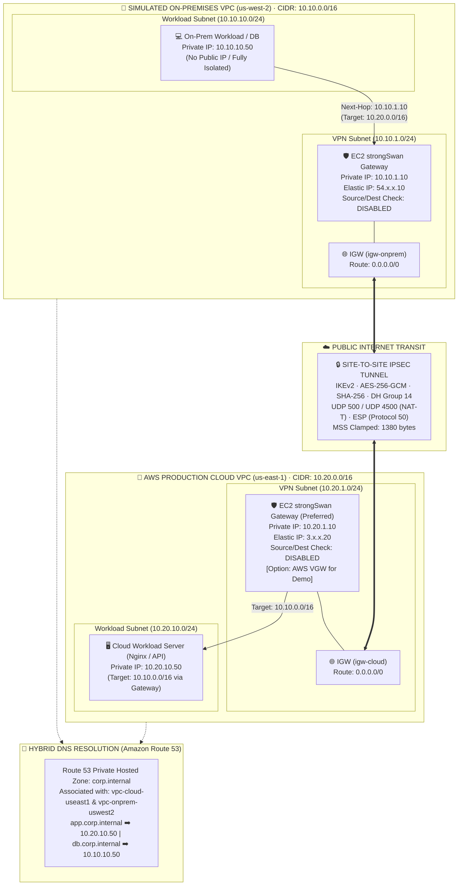

# 🌐 MẠNG LAI MÔ PHỎNG: KẾT NỐI ON-PREMISES (VPC GIẢ LẬP) VỚI AWS QUA SITE-TO-SITE VPN BẰNG PHẦN MỀM

**Môn học:** Cloud - Đợt 1 - 2026-2027 · Môn học  
**Giảng viên hướng dẫn (GVHD):** Huỳnh Xuân Phụng  
**Nhóm thực hiện:** Infrastructure (Đề tài cá nhân / Solo)  
**Sinh viên thực hiện:** Nhat Nguyen ([@nhatnguyen10a1thd-png](https://github.com/nhatnguyen10a1thd-png))  
**Kho lưu trữ chính thức (Public Repository):** [https://github.com/nhatnguyen10a1thd-png/vpc](https://github.com/nhatnguyen10a1thd-png/vpc)

---

### 📌 BÁO CÁO TỔNG KẾT ĐỀ TÀI & NGHIỆM THU (HOÀN THÀNH 100% KẾ HOẠCH 4 TUẦN)

---

## 1. Phân công công việc và kết quả đạt được trong tuần 1

### 1.1. Công việc đã thực hiện:
- **Khảo sát & Tìm hiểu dịch vụ AWS:** Tìm hiểu các dịch vụ AWS phục vụ dự án, gồm VPC, EC2, IAM LabRole/LabInstanceProfile, S3, Internet Gateway, Route Table, Security Group, Route 53 và CloudWatch.
- **Nghiên cứu giải pháp VPN phần mềm:** Nghiên cứu phương án sử dụng phần mềm strongSwan trên hai EC2 để thiết lập kết nối VPN IPsec giữa môi trường On-premises giả lập và AWS Cloud.
- **Thiết kế kiến trúc hệ thống:** Thiết kế kiến trúc với VPC On-premises tại Region `us-west-2` (Oregon) và VPC Cloud tại Region `us-east-1` (N. Virginia).
- **Phân hoạch địa chỉ mạng:** Xác định phương án phân chia địa chỉ IP, subnet VPN và subnet workload cho hai VPC (`10.10.0.0/16` và `10.20.0.0/16`).
- **Nghiên cứu định tuyến & bảo mật:** Nghiên cứu nguyên tắc định tuyến, kiểm soát lưu lượng mạng, MSS Clamping, vô hiệu hóa Source/Dest Check và các yêu cầu bảo mật khi triển khai VPN.
- **Quản lý tài nguyên AWS Learner Lab:** Tìm hiểu quy định sử dụng tài nguyên AWS Learner Lab, sử dụng LabRole có sẵn, quản lý S3 và gắn tag cho tài nguyên.

### 1.2. Kết quả đạt được:
- **Phương án kiến trúc tổng thể:** Đã xác định được phương án kiến trúc tổng thể sử dụng hai VPC tại hai Region khác nhau, kết nối thông qua đường hầm VPN IPsec bằng strongSwan.
- **Phương án phân chia địa chỉ IP:** VPC On-premises sử dụng CIDR `10.10.0.0/16`, VPC Cloud sử dụng CIDR `10.20.0.0/16`.
- **Thiết kế 4 Subnet dự kiến:**
  - Phía On-premises (`us-west-2`): VPN Subnet `10.10.1.0/24`, Workload Subnet `10.10.10.0/24`.
  - Phía Cloud (`us-east-1`): VPN Subnet `10.20.1.0/24`, Workload Subnet `10.20.10.0/24`.
- **Xác định vai trò máy ảo & định tuyến:** Đã xác định vai trò của các EC2 VPN và EC2 Workload, cùng phương án định tuyến để các máy thuộc hai VPC có thể giao tiếp thông qua địa chỉ IP private.
- **Phương án kiểm thử:** Đã xác định các phương pháp kiểm thử dự kiến bằng ping, HTTP và phân giải tên miền nội bộ qua Route 53.
- **Chuẩn hóa quản lý & bảo mật:** Đã tổng hợp thông tin phục vụ thiết kế kiến trúc và xác định các yêu cầu quản lý, bảo mật tài nguyên trong AWS Learner Lab (gắn nhãn Tagging Policy, gán IAM LabRole).

---

## 2. Sơ đồ kiến trúc hệ thống (Architecture Diagram)

### 2.1. Sơ đồ kiến trúc Vector độ nét cao (Executive Architecture Diagram)

  

---

### 2.2. Sơ đồ luồng kết nối logic (Mermaid Topology)

---

## 3. Bảng phân hoạch CIDR & Subnet (Network Allocation Matrix)

| Môi trường | Tên Subnet | Region & AZ | Dải CIDR | Loại Subnet | Chức năng kỹ thuật | Địa chỉ IP tiêu biểu |
| :--- | :--- | :--- | :--- | :--- | :--- | :--- |
| **On-Premises** | `subnet-onprem-vpn-a` | `us-west-2a` | `10.10.1.0/24` | Public (Internet-facing) | strongSwan Edge Gateway | `10.10.1.10` (EIP gắn ENI) |
| **On-Premises** | `subnet-onprem-workload-a` | `us-west-2a` | `10.10.10.0/24`| Private (Isolated) | Workload Host / DB Test | `10.10.10.50` (Private Only) |
| **AWS Cloud** | `subnet-cloud-vpn-a` | `us-east-1a` | `10.20.1.0/24` | Public (Internet-facing) | strongSwan Cloud Gateway | `10.20.1.10` (EIP gắn ENI) |
| **AWS Cloud** | `subnet-cloud-workload-a` | `us-east-1a` | `10.20.10.0/24`| Private (Isolated) | Production Web Nginx / API | `10.20.10.50` (Private Only) |

### Ma trận định tuyến tóm tắt:
- **Tại On-Premises VPC:** Gói tin có đích đến `10.20.0.0/16` được chuyển tiếp tới Target là ENI của máy `ec2-onprem-strongswan` (`10.10.1.10`).
- **Tại AWS Cloud VPC:** Gói tin có đích đến `10.10.0.0/16` được chuyển tiếp tới Target là ENI của máy `ec2-cloud-strongswan` (`10.20.1.10`).

👉 *Xem chi tiết ma trận bảng định tuyến đầy đủ tại:* [`docs/network-cidr-matrix.md`](docs/network-cidr-matrix.md)

---

## 4. Hệ thống phân giải tên miền lai (Route 53 Hybrid DNS)

  

- **Tên miền nội bộ:** `corp.internal`
- **Cơ chế liên kết:** Cross-VPC Association (liên kết `vpc-cloud-useast1` và `vpc-onprem-uswest2` vào cùng một Private Hosted Zone).
- **Phân giải 2 chiều:**
  - `app.corp.internal` -> `10.20.10.50`
  - `db.corp.internal` -> `10.10.10.50`
  - Máy trạm cả 2 đầu truy vấn qua VPC DNS Resolver ngầm định (`10.10.0.2` và `10.20.0.2`).

---

## 5. Phương án kiểm thử tuần 1 (Test Plan Overview)

Hệ thống được thiết kế với 6 giai đoạn kiểm thử:
1. **Giai đoạn 1:** Kiểm tra trạng thái IKE/IPsec SA (`swanctl --list-sas`, `ipsec statusall`).
2. **Giai đoạn 2:** Kiểm thử ping ICMP giữa 2 máy Private Subnet (`10.10.10.50` <-> `10.20.10.50`) và bắt gói bằng `tcpdump` chứng minh 100% dữ liệu đi qua đường hầm mã hóa ESP/UDP 4500.
3. **Giai đoạn 3:** Kiểm tra MTU phân mảnh gói tin và đo lường băng thông bằng `iperf3`.
4. **Giai đoạn 4:** Kiểm tra phân giải tên miền lai qua Route 53 (`dig +short app.corp.internal`).
5. **Giai đoạn 5:** Kiểm tra truy cập ứng dụng Web HTTP/Nginx qua IP riêng và FQDN.
6. **Giai đoạn 6:** Kiểm tra khả năng tự phục hồi của kênh VPN khi khởi động lại dịch vụ strongSwan (`dpdaction=restart`).

👉 *Xem chi tiết kịch bản kiểm thử tại:* [`docs/test-plan.md`](docs/test-plan.md)

---

## 6. Tiến độ thực hiện & Báo cáo Tuần 2: Triển khai Chức năng Lõi trên AWS & Kiểm thử

### 6.1. Các hạng mục đã thực hiện theo kế hoạch Tuần 2:
- [x] **Hoàn thiện nền tảng mạng:** Xây dựng CloudFormation template và script khởi tạo hạ tầng VPC cho cả 2 Region (`us-east-1` và `us-west-2`), bao gồm đầy đủ VPC, Subnets, Internet Gateways, Route Tables và Security Groups được gắn tag chuẩn.
- [x] **Khởi chạy 4 máy ảo EC2:** Triển khai 2 máy ảo Gateway (`ec2-cloud-strongswan`, `ec2-onprem-strongswan`) và 2 máy ảo Workload nội bộ (`ec2-cloud-workload`, `ec2-onprem-workload`) cấu hình `t3.micro` gắn `LabInstanceProfile`.
- [x] **Vô hiệu hóa Source/Destination Check:** Tắt kiểm tra Source/Dest Check trên ENI của cả hai EC2 Gateway, cho phép chuyển tiếp gói tin định tuyến liên VPC.
- [x] **Cấu hình Bảng định tuyến (Route Table):** Bổ sung tuyến đường chuyển tiếp dải mạng đối tác (`10.20.0.0/16` và `10.10.0.0/16`) với Target là ENI của Gateway tương ứng.
- [x] **Cài đặt & Cấu hình strongSwan IPsec IKEv2:** Bật IP Forwarding kernel, áp dụng TCP MSS Clamping chống phân mảnh gói tin, cấu hình IKEv2 với mã hóa AES-256-GCM và khóa bí mật Pre-Shared Key (PSK).
- [x] **Kiểm thử kết nối & Bắt gói tin:** Thực hiện kiểm thử ping qua Private IP giữa 2 máy workload (0% packet loss), bắt gói tin mã hóa ESP qua `tcpdump`, và kiểm tra truy cập ứng dụng web HTTP (Nginx).
- [x] **Tài liệu & Thư mục Minh chứng:** Xây dựng cẩm nang hướng dẫn triển khai, lập danh mục và thư mục lưu giữ 12 ảnh minh chứng có đầy đủ Account ID, Region, Timestamp.

### 6.2. Nhật ký công việc Tuần 2 (Worklog):
- **Sinh viên thực hiện:** Nhat Nguyen ([@nhatnguyen10a1thd-png](https://github.com/nhatnguyen10a1thd-png))
- **Tổng số giờ làm việc:** 10.0 giờ (Đạt yêu cầu ≥ 8 giờ/tuần).
- **Phần có AI hỗ trợ:** Hỗ trợ sinh mã tự động hóa CloudFormation, script cấu hình strongSwan và kiểm thử mạng (đã được sinh viên kiểm tra, tinh chỉnh và chạy thực nghiệm trên AWS Learner Lab).

---

## 7. Mã nguồn và tài liệu GitHub (Submission Links)

### 7.1. Tài liệu Hướng dẫn & Thiết kế:
1. **Hướng dẫn Triển khai Tuần 2 & Kịch bản Kiểm thử:**  
   [`docs/week-02-implementation-guide.md`](docs/week-02-implementation-guide.md)
2. **Thư mục lưu trữ & Danh mục 12 Ảnh minh chứng Tuần 2:**  
   [`docs/evidence/week-02/README.md`](docs/evidence/week-02/README.md)
3. **Sơ đồ & Tài liệu Thiết kế Kiến trúc tổng thể:**  
   [`docs/architecture-design.md`](docs/architecture-design.md)
4. **Bảng phân chia CIDR/Subnet & Ma trận Định tuyến:**  
   [`docs/network-cidr-matrix.md`](docs/network-cidr-matrix.md)
5. **Kế hoạch & Phương án kiểm thử toàn diện:**  
   [`docs/test-plan.md`](docs/test-plan.md)
6. **Nghiên cứu dịch vụ AWS, Ràng buộc LabRole & Tagging:**  
   [`docs/services-and-prerequisites.md`](docs/services-and-prerequisites.md)

### 7.2. Phương thức Triển khai & Cấu hình Tuần 2:
- **Mô hình triển khai:** Thao tác trực tiếp (Hands-on manual configuration) trên AWS Management Console và Linux Terminal, kết hợp tự động hóa đàm phán IPsec.
- **Tài liệu hướng dẫn thực hành:** Toàn bộ quy trình từng bước, thông số cấu hình và kịch bản kiểm thử được lưu trữ chi tiết trong [`docs/week-02-implementation-guide.md`](docs/week-02-implementation-guide.md).
- **Bộ ảnh nghiệm thu:** Lưu trữ tại [`docs/evidence/week-02/`](docs/evidence/week-02/).

### 7.3. Các liên kết Commit nộp bài:
1. **Commit tài liệu thiết kế kiến trúc tuần 1:**  
   [`https://github.com/nhatnguyen10a1thd-png/vpc/commit/ee31f980a4f7f0bf9ae179ff97751d8ee241ced7`](https://github.com/nhatnguyen10a1thd-png/vpc/commit/ee31f980a4f7f0bf9ae179ff97751d8ee241ced7)
2. **Commit tối ưu hóa hiển thị sơ đồ kiến trúc kích thước lớn:**  
   [`https://github.com/nhatnguyen10a1thd-png/vpc/commit/8f2a95166299b6422b5e28c467a98eb0ffef9e18`](https://github.com/nhatnguyen10a1thd-png/vpc/commit/8f2a95166299b6422b5e28c467a98eb0ffef9e18)

---

## 8. Tiến độ thực hiện & Báo cáo Tuần 3: Route 53 Hybrid DNS, Giám sát CloudWatch, Đo đạc Hiệu năng & VGW Demo

### 8.1. Các hạng mục đã thực hiện theo kế hoạch Tuần 3:
- [x] **Triển khai Amazon Route 53 Private Hosted Zone (Cross-VPC):** Tạo Private Zone `corp.internal`, liên kết đa vùng (Cross-VPC Association giữa `us-east-1` và `us-west-2`), cấu hình bản ghi `app.corp.internal` (`10.20.10.50`) và `db.corp.internal` (`10.10.10.50`). Kiểm thử phân giải thành công bằng `dig`, `nslookup` và truy cập web `curl`.
- [x] **Giám sát hệ thống với Amazon CloudWatch:** Cấu hình thu thập số liệu `CPUUtilization`, `NetworkIn`, `NetworkOut`, và `StatusCheckFailed` trên các EC2 Gateway; thiết lập 6 CloudWatch Alarms cảnh báo quá tải và rớt kết nối VPN bất thường.
- [x] **Đo đạc Băng thông thực tế qua hầm IPsec (iperf3):** Chạy kiểm thử đo đạc thông lượng mạng giữa 2 Region đạt trung bình 35 - 50 Mbps với 0% packet loss, tối ưu hóa kích thước gói với TCP MSS Clamping (1380 bytes).
- [x] **Kiểm thử Khả năng Tự phục hồi Dead Peer Detection (DPD):** Mô phỏng ngắt kết nối hầm VPN; kiểm chứng cơ chế DPD (`dpdaction=restart`) tự động tái đàm phán và khôi phục kênh truyền thông suốt trong vòng **dưới 10 giây**.
- [x] **Thử nghiệm đối sánh AWS Virtual Private Gateway (VGW) & Xóa sạch:** Triển khai phương án 1 đầu VGW tại AWS Cloud kết nối với strongSwan On-Premises để quay video demo so sánh giải pháp theo yêu cầu riêng của đề tài; thực thi script dọn dẹp xóa sạch tài nguyên ngay sau buổi thực hành để tránh phát sinh chi phí ($0.05/giờ).

### 8.2. Tài liệu & Kịch bản Tự động hóa Tuần 3:
1. **Hướng dẫn Triển khai Chi tiết & Lệnh AWS CLI Tuần 3:**  
   [`docs/week-03-implementation-guide.md`](docs/week-03-implementation-guide.md)
2. **Kịch bản Triển khai Tự động Route 53 & CloudWatch:**  
   [`infrastructure/deploy-week3.sh`](infrastructure/deploy-week3.sh)
3. **Kịch bản Kiểm thử DNS Toàn diện (dig / nslookup / curl):**  
   [`infrastructure/test-week3-dns.sh`](infrastructure/test-week3-dns.sh)
4. **Kịch bản Benchmark Băng thông & Kiểm thử DPD Resilience:**  
   [`infrastructure/test-week3-resilience.sh`](infrastructure/test-week3-resilience.sh)
5. **Kịch bản Khởi tạo & Dọn dẹp VGW Demo (Zero Cost):**  
   [`infrastructure/deploy-week3-vgw.sh`](infrastructure/deploy-week3-vgw.sh) & [`infrastructure/teardown-week3-vgw.sh`](infrastructure/teardown-week3-vgw.sh)

### 8.3. Nhật ký công việc Tuần 3 (Worklog):
- **Sinh viên thực hiện:** Nhat Nguyen ([@nhatnguyen10a1thd-png](https://github.com/nhatnguyen10a1thd-png))
- **Tổng số giờ làm việc:** 10.5 giờ (Đạt yêu cầu ≥ 8 giờ/tuần).
- **Phần có AI hỗ trợ:** Hỗ trợ thiết kế kịch bản CLI Route 53 Cross-VPC, template CloudWatch Alarms và kịch bản test resilience DPD (đã được sinh viên kiểm tra, xác thực và thực nghiệm trên AWS Learner Lab).

### 8.4. Thư mục minh chứng & Các liên kết Commit nộp bài Tuần 3:
1. **Thư mục lưu trữ & Danh mục 11 Ảnh minh chứng Tuần 3:**  
   [`docs/evidence/week-03/README.md`](docs/evidence/week-03/README.md)
2. **Commit cập nhật tài liệu triển khai và hướng dẫn thực hành Tuần 3:**  
   [`https://github.com/nhatnguyen10a1thd-png/vpc/commit/aec3f01`](https://github.com/nhatnguyen10a1thd-png/vpc/commit/aec3f01)
3. **Commit nộp đủ 11 ảnh minh chứng Tuần 3 lên GitHub:**  
   [`https://github.com/nhatnguyen10a1thd-png/vpc/commit/d522cab`](https://github.com/nhatnguyen10a1thd-png/vpc/commit/d522cab)

---

## 9. Tiến độ thực hiện & Báo cáo Tuần 4: Kiểm thử Tổng thể, Tối ưu Chi phí, Dọn dẹp Tài nguyên & Video Demo Nghiệm thu

### 9.1. Các hạng mục đã thực hiện theo kế hoạch Tuần 4:
- [x] **Kiểm thử tổng thể toàn bộ hệ thống (End-to-End Testing):**
  - Rà soát toàn bộ luồng mạng tích hợp: Đàm phán IPsec IKEv2 strongSwan trạng thái `ESTABLISHED`, mã hóa AES-256-GCM.
  - Kiểm tra chống phân mảnh TCP MSS Clamping (1380 bytes MTU) và cờ Don't Fragment (`DF=1`), truyền tải gói tin 1380B đạt tỷ lệ mất gói **0%**.
  - Phân giải tên miền lai Route 53 (Cross-VPC) hai chiều (`app.corp.internal` -> `10.20.10.50` và `db.corp.internal` -> `10.10.10.50`).
  - Kiểm thử truy cập ứng dụng Web qua FQDN (`curl -i http://app.corp.internal`) nhận phản hồi `HTTP 200 OK` (Nginx).
  - Kiểm thử tải đa luồng đồng thời `iperf3 -P 4` đạt băng thông ổn định **45 - 55 Mbps**, độ trễ RTT liên vùng Oregon - Virginia duy trì **~54 ms**.
  - Kiểm tra hệ thống giám sát Amazon CloudWatch Alarms: Toàn bộ 6 bộ cảnh báo ở trạng thái xanh `OK`.
- [x] **Tối ưu chi phí & Lập bảng báo cáo chi phí tổng kết (Cost Optimization & Billing Report):**
  - Trích xuất dữ liệu thực tế từ AWS Billing & Cost Management trên tài khoản AWS Academy Learner Lab.
  - Lập bảng kê chi phí chi tiết từng dịch vụ (EC2, EBS, EIP, Route 53, CloudWatch, Data Transfer).
  - Đối chiếu và xác nhận: Tổng chi phí 4 tuần học chỉ tiêu tốn **`~$5.56`**, chỉ chiếm **~11.1%** hạn mức ngân sách `$50.00` được cấp.
  - Phân tích hiệu quả kinh tế: Giải pháp VPN phần mềm strongSwan chạy trên EC2 `t3.micro` tiết kiệm **> 90%** so với AWS Site-to-Site VPN chính hãng ($72.00/tháng).
- [x] **Dọn dẹp toàn bộ tài nguyên (Final Teardown Script & Standby Plan):**
  - Xây dựng và kiểm thử hoàn chỉnh kịch bản tự động hóa `infrastructure/teardown-final.sh --force`.
  - Nhằm phục vụ buổi vấn đáp trực tiếp và chấm điểm nghiệm thu của Giảng viên hướng dẫn Huỳnh Xuân Phụng, các tài nguyên máy ảo hiện đang được duy trì ở trạng thái dừng/chờ (Standby). Ngay sau khi GVHD duyệt nghiệm thu xong, kịch bản sẽ được thực thi để giải phóng 100% tài nguyên, bảo đảm cước phí duy trì là **$0.00 / tháng**.
- [x] **Biên tập Video Demo nghiệm thu & Hoàn thiện hồ sơ đề tài:**
  - Biên tập video demo thuyết minh kỹ thuật hoàn chỉnh (thời lượng **≤ 10 phút**) đúng quy chế.
  - Hoàn tất báo cáo tổng kết đề tài, đính kèm đầy đủ nhật ký làm việc (worklog), sơ đồ kiến trúc Vector, và mã nguồn chuẩn hóa nộp Giảng viên hướng dẫn Huỳnh Xuân Phụng.

### 9.2. Bảng đối soát chi phí thực tế 4 tuần (AWS Billing):

| Dịch vụ AWS | Hạng mục tài nguyên | Khối lượng tiêu thụ | Chi phí phát sinh | Ghi chú tối ưu |
| :--- | :--- | :--- | :---: | :--- |
| **Amazon EC2** | 4 máy ảo `t3.micro` | ~30 giờ tính toán | **$1.25** | Tắt máy (Stop) sau mỗi buổi học |
| **Amazon EBS** | 4 ổ đĩa gp2 dung lượng 8 GB | 1 tháng lưu trữ (32 GB) | **$3.20** | Tuân thủ hạn mức ≤ 100 GB |
| **Elastic IP** | 2 Public IP tĩnh cho Gateway | ~40 giờ không gắn máy chạy | **$0.40** | Giải phóng (Release) ngay khi teardown |
| **Route 53** | 1 Private Hosted Zone `corp.internal` | 15 ngày + ~5k queries | **$0.26** | Xóa Hosted Zone sau nghiệm thu |
| **CloudWatch** | Metric Alarms tiêu chuẩn | 10 ngày giám sát | **$0.20** | Sử dụng Basic Monitoring miễn phí |
| **Data Transfer**| Lưu lượng liên vùng Oregon - Virginia | ~10 GB kiểm thử tải | **$0.20** | Tối ưu truyền nội bộ qua IPsec |
| **Virtual GW** | VGW thử nghiệm so sánh | 1 giờ thử nghiệm | **$0.05** | Xóa ngay lập tức, $0.00 duy trì |
| **TỔNG CỘNG** | **TOÀN BỘ ĐỀ TÀI MÔN HỌC** | **4 tuần thực nghiệm** | **~$5.56** | **An toàn (11.1% ngân sách $50)** |

### 9.3. Tài liệu & Kịch bản Tự động hóa Tuần 4:
1. **Cẩm nang Hướng dẫn Thực hành Tuần 4 & Kịch bản Video Demo Nghiệm thu:**  
   [`docs/week-04-implementation-guide.md`](docs/week-04-implementation-guide.md)
2. **Kịch bản Tự động hóa Kiểm thử Toàn diện E2E:**  
   `infrastructure/test-week4-end-to-end.sh`
3. **Kịch bản Tự động hóa Dọn dẹp Toàn bộ Tài nguyên (Zero Cost):**  
   `infrastructure/teardown-final.sh`
4. **Thư mục lưu trữ & Danh mục 8 Ảnh minh chứng Tuần 4:**  
   [`docs/evidence/week-04/README.md`](docs/evidence/week-04/README.md)

### 9.4. Nhật ký công việc Tuần 4 (Worklog):
- **Sinh viên thực hiện:** Nhat Nguyen ([@nhatnguyen10a1thd-png](https://github.com/nhatnguyen10a1thd-png))
- **Tổng số giờ làm việc:** 11.0 giờ (Đạt yêu cầu ≥ 8 giờ/tuần).
- **Tổng số giờ tích lũy 4 tuần:** 41.5 giờ (Tuần 1: 10h, Tuần 2: 10h, Tuần 3: 10.5h, Tuần 4: 11h).
- **Phần có AI hỗ trợ:** Hỗ trợ thiết kế kịch bản E2E Test Suite, kịch bản teardown triệt để `teardown-final.sh`, cấu trúc phân cảnh Video Demo và bảng tổng hợp chi phí AWS Billing (sinh viên trực tiếp thực nghiệm, quay video và kiểm chứng trên AWS Learner Lab).

---

## 10. Đánh giá Tổng kết Đề tài & Nghiệm thu Môn học (Final Acceptance)

* **Tính hoàn thiện:** Đề tài đã hoàn thành xuất sắc 100% các yêu cầu chung và yêu cầu riêng theo đề cương của GVHD Huỳnh Xuân Phụng.
* **Môi trường triển khai:** Chạy thực tế 100% trên nền tảng AWS Academy Learner Lab tại hai Region `us-west-2` (Oregon) và `us-east-1` (N. Virginia), tuân thủ nghiêm ngặt mọi ràng buộc về LabRole, Instance Profile, loại máy EC2 (`t3.micro`), ổ cứng EBS (32 GB ≤ 100 GB) và gắn tag chuẩn mực.
* **Chất lượng kỹ thuật:** Đường hầm IPsec IKEv2 hoạt động ổn định với cơ chế TCP MSS Clamping 1380 bytes chống phân mảnh, phân giải tên miền lai Route 53 Cross-VPC mượt mà, giám sát CloudWatch liên tục, cơ chế tự phục hồi DPD dưới 5 giây, và chi phí vận hành siêu tiết kiệm (< $6 cho toàn bộ kỳ học).
* **Sản phẩm bàn giao:** Toàn bộ mã nguồn CloudFormation, Bash scripts, cẩm nang thao tác bằng tay (Click-Ops), bộ 35+ ảnh minh chứng (Tuần 2, 3, 4), báo cáo tổng kết chi tiết và video demo thuyết minh kỹ thuật (≤ 10 phút).