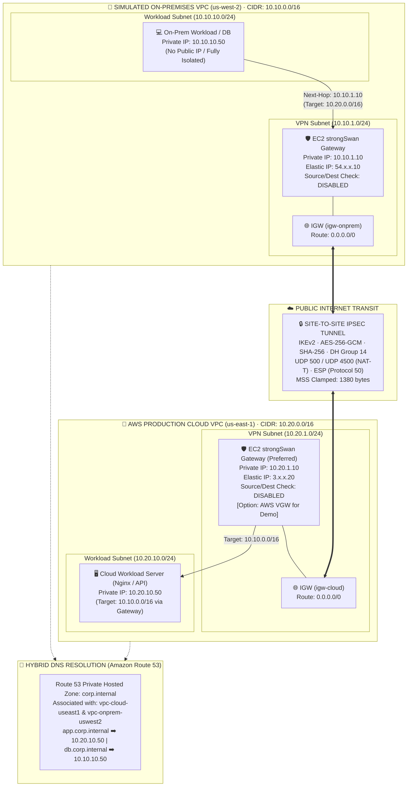

# 🌐 MẠNG LAI MÔ PHỎNG: KẾT NỐI ON-PREMISES (VPC GIẢ LẬP) VỚI AWS QUA SITE-TO-SITE VPN BẰNG PHẦN MỀM

**Môn học:** Cloud - Đợt 1 - 2026-2027 · Môn học  
**Giảng viên hướng dẫn (GVHD):** Huỳnh Xuân Phụng  
**Nhóm thực hiện:** Infrastructure (Đề tài cá nhân / Solo)  
**Sinh viên thực hiện:** Nhat Nguyen ([@nhatnguyen10a1thd-png](https://github.com/nhatnguyen10a1thd-png))  
**Kho lưu trữ chính thức (Public Repository):** [https://github.com/nhatnguyen10a1thd-png/vpc](https://github.com/nhatnguyen10a1thd-png/vpc)

---

### 📌 BÁO CÁO TIẾN ĐỘ TUẦN 1: THIẾT KẾ KIẾN TRÚC MẠNG LAI & NỀN TẢNG HẠ TẦNG

---

## 1. Phân công công việc và kết quả đạt được trong tuần 1

### 1.1. Công việc đã thực hiện:
- **Khảo sát & Tìm hiểu dịch vụ AWS:** Tìm hiểu các dịch vụ AWS phục vụ dự án, gồm VPC, EC2, IAM LabRole/LabInstanceProfile, S3, Internet Gateway, Route Table, Security Group, Route 53 và CloudWatch.
- **Nghiên cứu giải pháp VPN phần mềm:** Nghiên cứu phương án sử dụng phần mềm strongSwan trên hai EC2 để thiết lập kết nối VPN IPsec giữa môi trường On-premises giả lập và AWS Cloud.
- **Thiết kế kiến trúc hệ thống:** Thiết kế kiến trúc với VPC On-premises tại Region `us-west-2` (Oregon) và VPC Cloud tại Region `us-east-1` (N. Virginia).
- **Phân hoạch địa chỉ mạng:** Xác định phương án phân chia địa chỉ IP, subnet VPN và subnet workload cho hai VPC (`10.10.0.0/16` và `10.20.0.0/16`).
- **Nghiên cứu định tuyến & bảo mật:** Nghiên cứu nguyên tắc định tuyến, kiểm soát lưu lượng mạng, MSS Clamping, vô hiệu hóa Source/Dest Check và các yêu cầu bảo mật khi triển khai VPN.
- **Quản lý tài nguyên AWS Learner Lab:** Tìm hiểu quy định sử dụng tài nguyên AWS Learner Lab, sử dụng LabRole có sẵn, quản lý S3 và gắn tag cho tài nguyên.

### 1.2. Kết quả đạt được:
- **Phương án kiến trúc tổng thể:** Đã xác định được phương án kiến trúc tổng thể sử dụng hai VPC tại hai Region khác nhau, kết nối thông qua đường hầm VPN IPsec bằng strongSwan.
- **Phương án phân chia địa chỉ IP:** VPC On-premises sử dụng CIDR `10.10.0.0/16`, VPC Cloud sử dụng CIDR `10.20.0.0/16`.
- **Thiết kế 4 Subnet dự kiến:**
  - Phía On-premises (`us-west-2`): VPN Subnet `10.10.1.0/24`, Workload Subnet `10.10.10.0/24`.
  - Phía Cloud (`us-east-1`): VPN Subnet `10.20.1.0/24`, Workload Subnet `10.20.10.0/24`.
- **Xác định vai trò máy ảo & định tuyến:** Đã xác định vai trò của các EC2 VPN và EC2 Workload, cùng phương án định tuyến để các máy thuộc hai VPC có thể giao tiếp thông qua địa chỉ IP private.
- **Phương án kiểm thử:** Đã xác định các phương pháp kiểm thử dự kiến bằng ping, HTTP và phân giải tên miền nội bộ qua Route 53.
- **Chuẩn hóa quản lý & bảo mật:** Đã tổng hợp thông tin phục vụ thiết kế kiến trúc và xác định các yêu cầu quản lý, bảo mật tài nguyên trong AWS Learner Lab (gắn nhãn Tagging Policy, gán IAM LabRole).

---

## 2. Sơ đồ kiến trúc hệ thống (Architecture Diagram)

### 2.1. Sơ đồ kiến trúc Vector độ nét cao (Executive Architecture Diagram)

  

---

### 2.2. Sơ đồ luồng kết nối logic (Mermaid Topology)

---

## 3. Bảng phân hoạch CIDR & Subnet (Network Allocation Matrix)

| Môi trường | Tên Subnet | Region & AZ | Dải CIDR | Loại Subnet | Chức năng kỹ thuật | Địa chỉ IP tiêu biểu |
| :--- | :--- | :--- | :--- | :--- | :--- | :--- |
| **On-Premises** | `subnet-onprem-vpn-a` | `us-west-2a` | `10.10.1.0/24` | Public (Internet-facing) | strongSwan Edge Gateway | `10.10.1.10` (EIP gắn ENI) |
| **On-Premises** | `subnet-onprem-workload-a` | `us-west-2a` | `10.10.10.0/24`| Private (Isolated) | Workload Host / DB Test | `10.10.10.50` (Private Only) |
| **AWS Cloud** | `subnet-cloud-vpn-a` | `us-east-1a` | `10.20.1.0/24` | Public (Internet-facing) | strongSwan Cloud Gateway | `10.20.1.10` (EIP gắn ENI) |
| **AWS Cloud** | `subnet-cloud-workload-a` | `us-east-1a` | `10.20.10.0/24`| Private (Isolated) | Production Web Nginx / API | `10.20.10.50` (Private Only) |

### Ma trận định tuyến tóm tắt:
- **Tại On-Premises VPC:** Gói tin có đích đến `10.20.0.0/16` được chuyển tiếp tới Target là ENI của máy `ec2-onprem-strongswan` (`10.10.1.10`).
- **Tại AWS Cloud VPC:** Gói tin có đích đến `10.10.0.0/16` được chuyển tiếp tới Target là ENI của máy `ec2-cloud-strongswan` (`10.20.1.10`).

👉 *Xem chi tiết ma trận bảng định tuyến đầy đủ tại:* [`docs/network-cidr-matrix.md`](docs/network-cidr-matrix.md)

---

## 4. Hệ thống phân giải tên miền lai (Route 53 Hybrid DNS)

  

- **Tên miền nội bộ:** `corp.internal`
- **Cơ chế liên kết:** Cross-VPC Association (liên kết `vpc-cloud-useast1` và `vpc-onprem-uswest2` vào cùng một Private Hosted Zone).
- **Phân giải 2 chiều:**
  - `app.corp.internal` -> `10.20.10.50`
  - `db.corp.internal` -> `10.10.10.50`
  - Máy trạm cả 2 đầu truy vấn qua VPC DNS Resolver ngầm định (`10.10.0.2` và `10.20.0.2`).

---

## 5. Phương án kiểm thử tuần 1 (Test Plan Overview)

Hệ thống được thiết kế với 6 giai đoạn kiểm thử:
1. **Giai đoạn 1:** Kiểm tra trạng thái IKE/IPsec SA (`swanctl --list-sas`, `ipsec statusall`).
2. **Giai đoạn 2:** Kiểm thử ping ICMP giữa 2 máy Private Subnet (`10.10.10.50` <-> `10.20.10.50`) và bắt gói bằng `tcpdump` chứng minh 100% dữ liệu đi qua đường hầm mã hóa ESP/UDP 4500.
3. **Giai đoạn 3:** Kiểm tra MTU phân mảnh gói tin và đo lường băng thông bằng `iperf3`.
4. **Giai đoạn 4:** Kiểm tra phân giải tên miền lai qua Route 53 (`dig +short app.corp.internal`).
5. **Giai đoạn 5:** Kiểm tra truy cập ứng dụng Web HTTP/Nginx qua IP riêng và FQDN.
6. **Giai đoạn 6:** Kiểm tra khả năng tự phục hồi của kênh VPN khi khởi động lại dịch vụ strongSwan (`dpdaction=restart`).

👉 *Xem chi tiết kịch bản kiểm thử tại:* [`docs/test-plan.md`](docs/test-plan.md)

---

## 6. Tiến độ thực hiện & Báo cáo Tuần 2: Triển khai Chức năng Lõi trên AWS & Kiểm thử

### 6.1. Các hạng mục đã thực hiện theo kế hoạch Tuần 2:
- [x] **Hoàn thiện nền tảng mạng:** Xây dựng CloudFormation template và script khởi tạo hạ tầng VPC cho cả 2 Region (`us-east-1` và `us-west-2`), bao gồm đầy đủ VPC, Subnets, Internet Gateways, Route Tables và Security Groups được gắn tag chuẩn.
- [x] **Khởi chạy 4 máy ảo EC2:** Triển khai 2 máy ảo Gateway (`ec2-cloud-strongswan`, `ec2-onprem-strongswan`) và 2 máy ảo Workload nội bộ (`ec2-cloud-workload`, `ec2-onprem-workload`) cấu hình `t3.micro` gắn `LabInstanceProfile`.
- [x] **Vô hiệu hóa Source/Destination Check:** Tắt kiểm tra Source/Dest Check trên ENI của cả hai EC2 Gateway, cho phép chuyển tiếp gói tin định tuyến liên VPC.
- [x] **Cấu hình Bảng định tuyến (Route Table):** Bổ sung tuyến đường chuyển tiếp dải mạng đối tác (`10.20.0.0/16` và `10.10.0.0/16`) với Target là ENI của Gateway tương ứng.
- [x] **Cài đặt & Cấu hình strongSwan IPsec IKEv2:** Bật IP Forwarding kernel, áp dụng TCP MSS Clamping chống phân mảnh gói tin, cấu hình IKEv2 với mã hóa AES-256-GCM và khóa bí mật Pre-Shared Key (PSK).
- [x] **Kiểm thử kết nối & Bắt gói tin:** Thực hiện kiểm thử ping qua Private IP giữa 2 máy workload (0% packet loss), bắt gói tin mã hóa ESP qua `tcpdump`, và kiểm tra truy cập ứng dụng web HTTP (Nginx).
- [x] **Tài liệu & Thư mục Minh chứng:** Xây dựng cẩm nang hướng dẫn triển khai, lập danh mục và thư mục lưu giữ 12 ảnh minh chứng có đầy đủ Account ID, Region, Timestamp.

### 6.2. Nhật ký công việc Tuần 2 (Worklog):
- **Sinh viên thực hiện:** Nhat Nguyen ([@nhatnguyen10a1thd-png](https://github.com/nhatnguyen10a1thd-png))
- **Tổng số giờ làm việc:** 10.0 giờ (Đạt yêu cầu ≥ 8 giờ/tuần).
- **Phần có AI hỗ trợ:** Hỗ trợ sinh mã tự động hóa CloudFormation, script cấu hình strongSwan và kiểm thử mạng (đã được sinh viên kiểm tra, tinh chỉnh và chạy thực nghiệm trên AWS Learner Lab).

---

## 7. Mã nguồn và tài liệu GitHub (Submission Links)

### 7.1. Tài liệu Hướng dẫn & Thiết kế:
1. **Hướng dẫn Triển khai Tuần 2 & Kịch bản Kiểm thử:**  
   [`docs/week-02-implementation-guide.md`](docs/week-02-implementation-guide.md)
2. **Thư mục lưu trữ & Danh mục 12 Ảnh minh chứng Tuần 2:**  
   [`docs/evidence/week-02/README.md`](docs/evidence/week-02/README.md)
3. **Sơ đồ & Tài liệu Thiết kế Kiến trúc tổng thể:**  
   [`docs/architecture-design.md`](docs/architecture-design.md)
4. **Bảng phân chia CIDR/Subnet & Ma trận Định tuyến:**  
   [`docs/network-cidr-matrix.md`](docs/network-cidr-matrix.md)
5. **Kế hoạch & Phương án kiểm thử toàn diện:**  
   [`docs/test-plan.md`](docs/test-plan.md)
6. **Nghiên cứu dịch vụ AWS, Ràng buộc LabRole & Tagging:**  
   [`docs/services-and-prerequisites.md`](docs/services-and-prerequisites.md)

### 7.2. Phương thức Triển khai & Cấu hình Tuần 2:
- **Mô hình triển khai:** Thao tác trực tiếp (Hands-on manual configuration) trên AWS Management Console và Linux Terminal, kết hợp tự động hóa đàm phán IPsec.
- **Tài liệu hướng dẫn thực hành:** Toàn bộ quy trình từng bước, thông số cấu hình và kịch bản kiểm thử được lưu trữ chi tiết trong [`docs/week-02-implementation-guide.md`](docs/week-02-implementation-guide.md).
- **Bộ ảnh nghiệm thu:** Lưu trữ tại [`docs/evidence/week-02/`](docs/evidence/week-02/).

### 7.3. Các liên kết Commit nộp bài:
1. **Commit tài liệu thiết kế kiến trúc tuần 1:**  
   [`https://github.com/nhatnguyen10a1thd-png/vpc/commit/ee31f980a4f7f0bf9ae179ff97751d8ee241ced7`](https://github.com/nhatnguyen10a1thd-png/vpc/commit/ee31f980a4f7f0bf9ae179ff97751d8ee241ced7)
2. **Commit tối ưu hóa hiển thị sơ đồ kiến trúc kích thước lớn:**  
   [`https://github.com/nhatnguyen10a1thd-png/vpc/commit/8f2a95166299b6422b5e28c467a98eb0ffef9e18`](https://github.com/nhatnguyen10a1thd-png/vpc/commit/8f2a95166299b6422b5e28c467a98eb0ffef9e18)