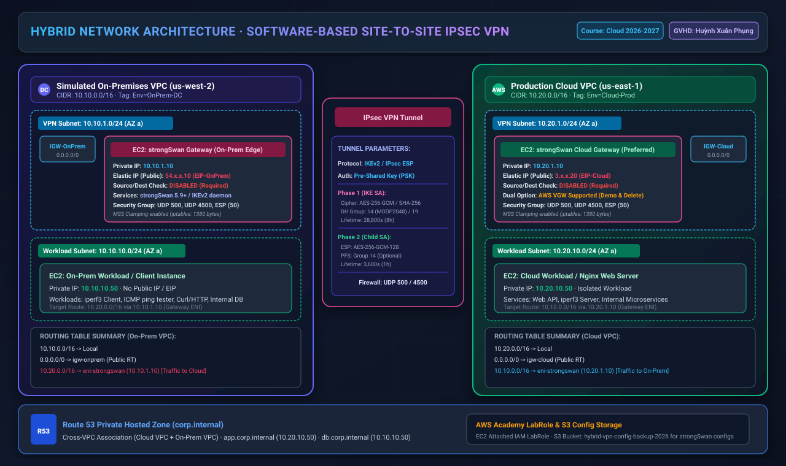
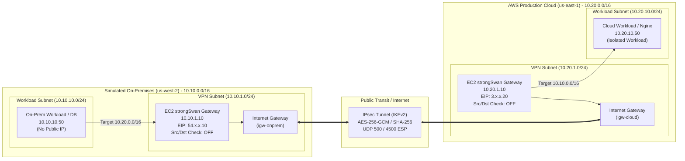
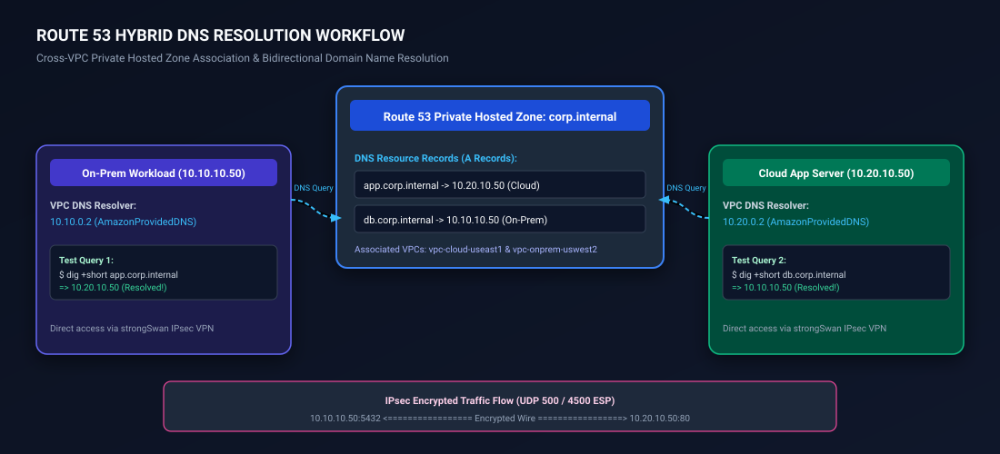

# Architecture Design: Software-Based Site-to-Site IPsec VPN (Simulated On-Premises to AWS Cloud)

> **Môn học:** Cloud - Đợt 1 - 2026-2027  
> **Giảng viên hướng dẫn (GVHD):** Huỳnh Xuân Phụng  
> **Nhóm thực hiện:** Infrastructure (Đề tài cá nhân / Solo)  
> **Sinh viên:** Nhat Nguyen ([@nhatnguyen10a1thd-png](https://github.com/nhatnguyen10a1thd-png))  
> **Giai đoạn:** Tuần 1 - Tìm hiểu dịch vụ, Thiết kế kiến trúc, Bảng phân hoạch mạng & Kế hoạch kiểm thử

---

## 1. Tổng quan kiến trúc (Architecture Overview)

Dự án triển khai mô hình **Hybrid Cloud Network** mô phỏng môi trường thực tế của doanh nghiệp:
- **Trung tâm dữ liệu On-Premises (Giả lập):** Được xây dựng trong một VPC độc lập tại AWS Region `us-west-2` (Oregon) với dải mạng doanh nghiệp `10.10.0.0/16`. Tại đây, một máy ảo EC2 đóng vai trò **Edge VPN Gateway** chạy phần mềm mã nguồn mở **strongSwan (IKEv2/IPsec)**.
- **Môi trường AWS Cloud (Production VPC):** Được triển khai tại AWS Region `us-east-1` (N. Virginia) với dải mạng `10.20.0.0/16`. Gateway đầu AWS Cloud ưu tiên sử dụng giải pháp phần mềm strongSwan trên EC2 (giải pháp 2 đầu phần mềm - Software-to-Software VPN) nhằm tối ưu chi phí học tập và kiểm soát toàn bộ cấu hình mã hóa; đồng thời thiết kế sẵn phương án tích hợp **AWS Virtual Private Gateway (VGW)** để demo tính năng Native AWS Site-to-Site VPN (tuân thủ nguyên tắc xóa ngay sau demo).
- **Hệ thống phân giải tên miền lai (Hybrid DNS):** Sử dụng **Amazon Route 53 Private Hosted Zone** (`corp.internal`) liên kết xuyên VPC (Cross-VPC Association) để các máy chủ ở cả hai môi trường truy cập nhau qua FQDN thay vì IP tĩnh.

### Sơ đồ kiến trúc tổng thể (Architecture Vector Diagram)



---

## 2. Chi tiết hai môi trường mạng (VPC Specifications)



### 2.1. VPC On-Premises (Giả lập tại `us-west-2`)
- **Tên VPC:** `vpc-onprem-uswest2`
- **CIDR Block:** `10.10.0.0/16`
- **VPN Subnet (Public Gateway Subnet):** `10.10.1.0/24` (Availability Zone: `us-west-2a`)
  - Chứa máy chủ `ec2-onprem-strongswan` (Private IP: `10.10.1.10`, gắn Elastic IP cố định).
  - Kết nối Internet Gateway `igw-onprem`.
- **Workload Subnet (Private Subnet):** `10.10.10.0/24` (Availability Zone: `us-west-2a`)
  - Chứa máy chủ kiểm thử/workload `ec2-onprem-app-db` (Private IP: `10.10.10.50`).
  - Hoàn toàn không có Public IP/Elastic IP; mọi lưu lượng sang AWS Cloud phải đi qua Next-hop là ENI của máy strongSwan (`10.10.1.10`).

### 2.2. VPC AWS Cloud (`us-east-1`)
- **Tên VPC:** `vpc-cloud-useast1`
- **CIDR Block:** `10.20.0.0/16`
- **VPN Subnet (Public Gateway Subnet):** `10.20.1.0/24` (Availability Zone: `us-east-1a`)
  - Chứa máy chủ `ec2-cloud-strongswan` (Private IP: `10.20.1.10`, gắn Elastic IP cố định).
  - Kết nối Internet Gateway `igw-cloud`.
- **Workload Subnet (Private Subnet):** `10.20.10.0/24` (Availability Zone: `us-east-1a`)
  - Chứa máy chủ dịch vụ `ec2-cloud-app-server` (Private IP: `10.20.10.50`, chạy Nginx / Web API / iperf3 server).
  - Tuyến định tuyến hướng gói tin đích `10.10.0.0/16` vào ENI của strongSwan Cloud Gateway (`10.20.1.10`).

---

## 3. Thiết kế chi tiết giao thức VPN & strongSwan IPsec

### 3.1. Các thông số đàm phán IPsec (IKEv2 Tunnel Specification)

| Tham số | Giai đoạn 1 (IKE SA / Phase 1) | Giai đoạn 2 (Child SA / Phase 2 ESP) | Ghi chú kỹ thuật |
| :--- | :--- | :--- | :--- |
| **Giao thức** | IKEv2 (Internet Key Exchange v2) | ESP (Encapsulating Security Payload) | IKEv2 kháng DoS, NAT-T chuẩn |
| **Thuật toán mã hóa** | `aes256gcm16` hoặc `aes256` | `aes256gcm16` hoặc `aes256` | Chuẩn bảo mật doanh nghiệp |
| **Hàm băm toàn vẹn** | `sha256` / `sha384` | GCM tích hợp AEAD / `sha256` | Bảo vệ chống can thiệp gói |
| **Diffie-Hellman Group** | Group 14 (`modp2048`) hoặc Group 19 (`ecp256`) | Group 14 (`modp2048`) với PFS | Perfect Forward Secrecy |
| **Phương thức xác thực** | Pre-Shared Key (PSK) | N/A (Kế thừa từ IKE SA) | Khóa bí mật đồng thuận 2 đầu |
| **Thời gian sống (Lifetime)**| 28,800 giây (8 giờ) | 3,600 giây (1 giờ) | Tự động rekey không gián đoạn |
| **Dead Peer Detection (DPD)**| `dpdaction=restart`, `dpddelay=30s` | N/A | Tự động khởi động lại nếu đứt link |

### 3.2. Cấu hình cổng Firewall & Security Group
Các cổng mạng bắt buộc phải mở trên Security Group của 2 đầu Gateway:
1. **UDP 500 (IKE):** Khởi tạo đàm phán kênh an toàn IKE SA.
2. **UDP 4500 (IPsec NAT-Traversal):** Đóng gói ESP qua UDP khi gói tin đi qua NAT của AWS.
3. **IP Protocol 50 (ESP):** Truyền tải dữ liệu mã hóa.
4. **ICMP (Echo Request/Reply):** Kiểm thử độ trễ và thông mạng.
5. **TCP 22 (SSH):** Quản trị từ IP quản trị viên.

### 3.3. Các cấu hình nhân hệ điều hành Linux (Kernel Sysctl & Routing)
Trên cả 2 máy chủ strongSwan (Ubuntu 22.04 LTS), nhân Linux phải được bật tính năng chuyển tiếp gói tin (Packet Forwarding) và tắt ICMP Redirects:

```ini
# /etc/sysctl.d/99-ipsec.conf
net.ipv4.ip_forward = 1
net.ipv4.conf.all.accept_redirects = 0
net.ipv4.conf.all.send_redirects = 0
net.ipv4.conf.default.rp_filter = 2
net.ipv4.conf.all.rp_filter = 2
```

### 3.4. Vô hiệu hóa tính năng "Source/Destination Check" trên AWS EC2
> [!CRITICAL]
> **Yêu cầu bắt buộc trên AWS:** Mặc định AWS EC2 thực hiện kiểm tra Source/Destination IP. Vì máy chủ strongSwan đóng vai trò Router trung chuyển gói tin có địa chỉ IP nguồn/đích thuộc subnet khác (`10.10.10.x` sang `10.20.10.x`), **phải tắt Source/Dest Check trên ENI của cả 2 máy EC2 strongSwan**. Nếu không tắt, AWS Hypervisor sẽ chặn toàn bộ gói tin định tuyến.

Lệnh thực thi AWS CLI:
```bash
aws ec2 modify-instance-attribute --instance-id <instance-id> --no-source-dest-check
```

### 3.5. Xử lý MTU và TCP MSS Clamping
Gói tin IPsec bổ sung tiêu đề ESP, UDP header và IV/ICV, làm tăng kích thước gói thêm ~50 - 70 bytes. Nếu gói tin ban đầu đạt 1500 bytes (chuẩn MTU Ethernet), hiện tượng phân mảnh (Packet Fragmentation) hoặc Packet Drop sẽ xảy ra.

Giải pháp: Áp dụng **TCP MSS Clamping** qua `iptables` trên cả 2 Gateway:
```bash
sudo iptables -t mangle -A FORWARD -p tcp --tcp-flags SYN,RST SYN -j TCPMSS --clamp-mss-to-pmtu
# Hoặc cố định MSS ở 1380 bytes:
sudo iptables -t mangle -A FORWARD -p tcp --tcp-flags SYN,RST SYN -j TCPMSS --set-mss 1380
```

---

## 4. Thiết kế hệ thống phân giải tên miền lai (Route 53 Hybrid DNS)

Để đạt mục tiêu của đề tài về dịch vụ **Route 53 (private zone)**, kiến trúc triển khai miền nội bộ:
- Tên miền: `corp.internal`
- Loại: Route 53 Private Hosted Zone (PHZ)
- Được liên kết (Associated) với cả hai VPC: `vpc-cloud-useast1` (`10.20.0.0/16`) và `vpc-onprem-uswest2` (`10.10.0.0/16`).



### Cơ chế liên kết Cross-VPC cho Private Hosted Zone:
1. Tạo Private Hosted Zone `corp.internal` gắn với `vpc-cloud-useast1` (tại `us-east-1`).
2. Sử dụng AWS CLI để tạo lệnh ủy quyền liên kết sang VPC On-Prem:
   ```bash
   aws route53 create-vpc-association-authorization \
       --hosted-zone-id <ZONE_ID> \
       --vpc VPCRegion=us-west-2,VPCId=<VPC_ONPREM_ID>
   ```
3. Thực hiện liên kết từ VPC `us-west-2`:
   ```bash
   aws route53 associate-vpc-with-hosted-zone \
       --hosted-zone-id <ZONE_ID> \
       --vpc VPCRegion=us-west-2,VPCId=<VPC_ONPREM_ID>
   ```
4. Kết quả: Cả máy trạm On-Prem và Cloud Server đều gửi truy vấn tới địa chỉ DNS nội bộ của VPC (`10.10.0.2` hoặc `10.20.0.2` - AmazonProvidedDNS) và tự động nhận diện được tên miền nội bộ của nhau mà không cần dựng Bind9 DNS phức tạp.

---

## 5. Phương án tùy chọn: AWS Virtual Private Gateway (VGW)

Nhóm thiết kế sẵn phương án Native AWS VPN để đối chiếu hiệu năng và quy trình thực tế:
- **Thành phần:**
  - **Virtual Private Gateway (VGW):** Đính kèm vào `vpc-cloud-useast1`.
  - **Customer Gateway (CGW):** Trỏ về Elastic IP của strongSwan phía On-Prem (`54.x.x.10`).
  - **Site-to-Site VPN Connection:** Tạo 2 IPsec tunnel tiêu chuẩn của AWS.
- **Quy tắc an toàn chi phí (Cost Management):**
  - Chi phí VGW là $0.05/giờ kết nối. Đối với tài khoản AWS Academy Lab, việc duy trì VGW dài ngày sẽ làm cạn kiệt ngân sách ($100 Lab credit).
  - **Quy trình bắt buộc:** Triển khai demo trong 15-30 phút, chụp hình chứng minh kết nối 2 Tunnel UP trên AWS Management Console, sau đó **xóa bỏ VGW & VPN Connection ngay lập tức**. Mọi hoạt động kiểm thử thường nhật được duy trì trên giải pháp phần mềm strongSwan 2 đầu (tối ưu chi phí).

---

## 6. Chính sách gắn nhãn tài nguyên (Standard Tagging Strategy)

Toàn bộ tài nguyên tuần 1 và các tuần tiếp theo được gắn nhãn đồng nhất theo chuẩn quản trị hạ tầng:

| Khóa nhãn (Tag Key) | Giá trị mẫu (Tag Value) | Mục đích |
| :--- | :--- | :--- |
| `Project` | `Hybrid-Cloud-VPN` | Định danh dự án |
| `Environment` | `Lab-Simulation` / `OnPrem-DC` / `Cloud-Prod` | Phân tách môi trường |
| `Course` | `Cloud-Dot1-2026-2027` | Thông tin môn học |
| `Instructor` | `HuynhXuanPhung` | Tên giảng viên hướng dẫn |
| `Owner` | `NhatNguyen` | Người chịu trách nhiệm |
| `Role` | `VPN-Gateway` / `Workload-Host` / `Network-Router` | Vai trò của tài nguyên |
| `ManagedBy` | `IaC-Script` | Phương thức khởi tạo |
