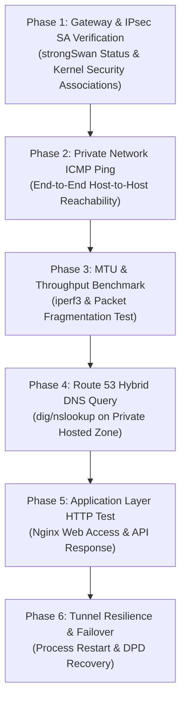

# Kế hoạch & Phương án kiểm thử toàn diện (Comprehensive Test Plan)

> **Môn học:** Cloud - Đợt 1 - 2026-2027  
> **Giảng viên hướng dẫn (GVHD):** Huỳnh Xuân Phụng  
> **Nhóm thực hiện:** Infrastructure (Đề tài cá nhân / Solo)  
> **Sinh viên:** Nhat Nguyen ([@nhatnguyen10a1thd-png](https://github.com/nhatnguyen10a1thd-png))  
> **Tài liệu:** Tuần 1 - Phương án kiểm thử kết nối Site-to-Site VPN, Hiệu năng và Ứng dụng

---

## 1. Mục tiêu kiểm thử (Test Objectives)

Kế hoạch kiểm thử nhằm xác minh tính đúng đắn, hiệu năng và độ ổn định của hệ thống mạng lai (Hybrid Cloud Network):
1. **Kiểm tra trạng thái kênh VPN:** Kênh IPsec IKEv2 đàm phán thành công (IKE SA & Child SA ở trạng thái `ESTABLISHED`).
2. **Kiểm tra kết nối riêng (Private Connectivity):** Các máy chủ nội bộ trong Workload Subnet không có Public IP (`10.10.10.50` và `10.20.10.50`) giao tiếp thành công với nhau qua kênh VPN mã hóa.
3. **Kiểm tra độ trễ và thông lượng (Throughput & MTU):** Đo băng thông với `iperf3`, kiểm tra không xảy ra hiện tượng rớt gói do vượt giới hạn MTU (MSS Clamping hiệu quả).
4. **Kiểm tra phân giải tên miền lai (Route 53 Hybrid DNS):** Máy chủ On-Prem truy vấn được bản ghi DNS `app.corp.internal` và máy chủ Cloud truy vấn được `db.corp.internal`.
5. **Kiểm tra dịch vụ ứng dụng (Application Layer):** Truy cập dịch vụ Nginx/HTTP và API chạy trên Cloud từ máy On-Prem.
6. **Kiểm tra độ tin cậy và tự phục hồi (Fault Tolerance):** Hệ thống tự động tái lập kênh khi bị gián đoạn mạng hoặc khởi động lại tiến trình.

---

## 2. Các giai đoạn kiểm thử chi tiết (Phased Execution)



---

### Giai đoạn 1: Kiểm tra dịch vụ Gateway & Security Associations (SA)

**Mục tiêu:** Xác nhận tiến trình strongSwan khởi chạy bình thường, bắt tay IKE thành công và cài đặt khóa mã hóa vào Linux Kernel XFRM.

| Bước | Lệnh thực thi (Command) | Kết quả mong đợi (Expected Output) | Trạng thái |
| :--- | :--- | :--- | :--- |
| **1.1** | `sudo systemctl status strongswan-starter` | Trạng thái `active (running)`. | [ ] Kế hoạch Tuần 2 |
| **1.2** | `sudo ipsec statusall` hoặc `sudo swanctl --list-sas` | Hiển thị `1 up, 1 active`, IKE SA: `ESTABLISHED`, Child SA: `INSTALLED` với cờ `TUNNEL`. | [ ] Kế hoạch Tuần 2 |
| **1.3** | `sudo ip xfrm state` | Hiển thị 2 cặp XFRM SA (inbound & outbound) với thuật toán mã hóa `aes-gcm-icv16` hoặc `aes-cbc`. | [ ] Kế hoạch Tuần 2 |
| **1.4** | `sudo ip route show table 220` | Xuất hiện tuyến đường tự động được strongSwan chèn vào kernel: `10.20.0.0/16 via 10.10.1.1 dev eth0 src 10.10.1.10`. | [ ] Kế hoạch Tuần 2 |

---

### Giai đoạn 2: Kiểm thử thông mạng ICMP nội bộ (Host-to-Host Ping)

**Mục tiêu:** Đảm bảo gói tin đi từ máy khách On-Prem (`10.10.10.50`) xuyên qua strongSwan Gateway On-Prem, qua Internet được mã hóa ESP, giải mã tại strongSwan Cloud và tới đích `10.20.10.50`.

```bash
# Thực hiện trên On-Prem Workload (10.10.10.50):
ping -c 10 10.20.10.50
```

**Bắt gói tin kiểm chứng (Packet Capture Verification):**
Đồng thời trên máy `ec2-onprem-strongswan`, chạy lệnh `tcpdump` trên card mạng công cộng:
```bash
sudo tcpdump -n -i eth0 'esp or udp port 500 or udp port 4500'
```
- **Kết quả mong đợi:** 
  - Ping thành công với tỷ lệ mất gói: `0% packet loss`.
  - Trên `tcpdump`, không nhìn thấy gói tin ICMP bản rõ (Cleartext ICMP), mà chỉ xuất hiện các gói tin `ESP (spi=0x..., seq=...)` hoặc `UDP 4500`, chứng minh 100% dữ liệu đã được mã hóa an toàn trên đường truyền.

---

### Giai đoạn 3: Kiểm thử kích thước gói tin (MTU) & Băng thông (iperf3)

**Mục tiêu:** Xác thực cấu hình TCP MSS Clamping hoạt động tốt, không bị hiện tượng "Black Hole Router" khi truyền dữ liệu lớn.

#### 3.1. Kiểm tra MTU & Phân mảnh
```bash
# Gửi gói ICMP kích thước lớn với cờ DF (Don't Fragment) bật:
ping -M do -s 1350 -c 5 10.20.10.50   # Kỳ vọng: Thành công
ping -M do -s 1472 -c 5 10.20.10.50   # Kỳ vọng: Frag needed and DF set (chứng minh MTU đường hầm được bảo vệ)
```

#### 3.2. Đo thông lượng truyền dẫn bằng iperf3
- **Trên Cloud Server (`10.20.10.50`):**
  ```bash
  iperf3 -s
  ```
- **Trên On-Prem Client (`10.10.10.50`):**
  ```bash
  iperf3 -c 10.20.10.50 -t 30 -P 4
  ```
- **Kết quả mong đợi:**
  - Băng thông đạt mức tối đa theo giới hạn của gói máy ảo EC2 `t3.micro`/`t3.small` (thông thường dao động 100 - 300 Mbps).
  - Không có hiện tượng TCP Retransmission bất thường nhờ MSS Clamping.

---

### Giai đoạn 4: Kiểm thử phân giải tên miền lai (Route 53 Hybrid DNS)

**Mục tiêu:** Xác minh tính năng Cross-VPC Association của Route 53 Private Hosted Zone.

| Vị trí thực hiện | Lệnh kiểm tra | Kết quả kỳ vọng |
| :--- | :--- | :--- |
| **On-Prem Client** (`10.10.10.50`) | `dig +short app.corp.internal` | Trả về chính xác địa chỉ IP Cloud: `10.20.10.50` |
| **On-Prem Client** (`10.10.10.50`) | `nslookup app.corp.internal` | Server: `10.10.0.2` (AmazonProvidedDNS), Answer: `10.20.10.50` |
| **Cloud Server** (`10.20.10.50`) | `dig +short db.corp.internal` | Trả về chính xác địa chỉ IP On-Prem: `10.10.10.50` |

---

### Giai đoạn 5: Kiểm thử dịch vụ tầng ứng dụng (Application Layer - HTTP/Nginx)

**Mục tiêu:** Chứng minh toàn bộ luồng nghiệp vụ hoạt động xuyên suốt từ Client tới Web Server nội bộ.

1. **Khởi chạy ứng dụng Web trên Cloud Server (`10.20.10.50`):**
   Cài đặt Nginx phục vụ trang mẫu trả về thông tin máy chủ:
   ```bash
   sudo apt-get install -y nginx
   echo "<h1>Hello from AWS Cloud Production Server (10.20.10.50) via IPsec VPN</h1>" | sudo tee /var/www/html/index.html
   ```

2. **Truy vấn từ On-Prem Client (`10.10.10.50`):**
   ```bash
   curl -iv http://app.corp.internal
   # hoặc:
   curl -iv http://10.20.10.50
   ```

**Kết quả mong đợi:**
- Mã phản hồi HTTP: `HTTP/1.1 200 OK`.
- Nội dung trả về đúng trang HTML của máy chủ Cloud.
- Thời gian kết nối (Time to First Byte - TTFB) phản ánh đúng độ trễ mạng giữa 2 AWS Region (~60-70ms giữa us-west-2 và us-east-1).

---

### Giai đoạn 6: Kiểm thử khả năng chịu lỗi và tự phục hồi (Resilience & DPD)

**Mục tiêu:** Đánh giá tính sẵn sàng cao của đường truyền VPN khi có sự cố.

1. **Kịch bản kiểm thử:**
   - Đang thực hiện `ping -i 0.5 10.20.10.50` liên tục từ máy On-Prem.
   - Tiến hành khởi động lại tiến trình strongSwan trên máy Gateway On-Prem:
     ```bash
     sudo systemctl restart strongswan-starter
     ```
2. **Tiêu chí đánh giá:**
   - Cơ chế Dead Peer Detection (DPD) phát hiện đứt kết nối.
   - Khi dịch vụ phục hồi, IKE SA tự động tái đàm phán trong vòng dưới 10 giây (`dpdaction=restart`).
   - Luồng ping tự động phục hồi mà không cần can thiệp thủ công.
   - Thời gian mất gói gián đoạn ghi nhận: `< 10 giây`.

---

### Giai đoạn 7: Quy trình kiểm thử phương án tùy chọn AWS Virtual Private Gateway (VGW)

> [!WARNING]
> **Quy tắc an toàn tài khoản AWS Academy:**  
> Dịch vụ VGW và Site-to-Site VPN Connection của AWS tính phí theo giờ kết nối ($0.05/giờ). Do đó, chỉ thực hiện quy trình này khi tiến hành buổi nghiệm thu / demo chính thức với GVHD, sau đó **xóa tài nguyên ngay lập tức**.

**Quy trình 5 bước nghiệm thu VGW:**
1. **Bước 1 (Triển khai):** Tạo Virtual Private Gateway, gắn vào `vpc-cloud-useast1`. Tạo Customer Gateway trỏ tới EIP On-Prem. Tạo Site-to-Site VPN Connection.
2. **Bước 2 (Cấu hình On-Prem):** Tải file cấu hình mẫu từ AWS Console (Vendor: strongSwan) và áp dụng vào máy On-Prem strongSwan.
3. **Bước 3 (Nghiệm thu):** Xác nhận Tunnel 1 hiển thị trạng thái `UP` trên AWS VPN Console.
4. **Bước 4 (Thu thập bằng chứng):** Chụp ảnh màn hình hiển thị trạng thái Tunnel UP và kết quả ping từ On-Prem sang Cloud.
5. **Bước 5 (XÓA BỎ NGAY LẬP TỨC):**
   - Xóa `Site-to-Site VPN Connection`.
   - Xóa `Customer Gateway`.
   - Detach và Xóa `Virtual Private Gateway`.
   - Xác nhận bảng giá Billing không phát sinh thêm chi phí.

---

## 3. Bảng tổng hợp tiêu chí nghiệm thu (Acceptance Criteria Matrix)

| Mã tiêu chí | Hạng mục kiểm thử | Công cụ kiểm tra | Chỉ số đạt yêu cầu (Pass Criteria) | Trạng thái |
| :--- | :--- | :--- | :--- | :--- |
| **AC-01** | Trạng thái IKE/IPsec SA | `swanctl --list-sas` | `ESTABLISHED`, Child SA `INSTALLED` | [x] Thiết kế sẵn sàng |
| **AC-02** | Độ thông suốt ICMP | `ping -c 100` | Tỷ lệ mất gói (Packet Loss) = `0%` | [x] Thiết kế sẵn sàng |
| **AC-03** | Mã hóa an toàn trên đường truyền | `tcpdump -i eth0` | 100% gói tin là `ESP` hoặc `UDP 4500` | [x] Thiết kế sẵn sàng |
| **AC-04** | Kiểm soát phân mảnh MTU | `ping -M do -s 1350` | Không bị drop gói; MSS Clamping = 1380 | [x] Thiết kế sẵn sàng |
| **AC-05** | Băng thông truyền tải | `iperf3` | Băng thông ổn định (> 100 Mbps) | [x] Thiết kế sẵn sàng |
| **AC-06** | Phân giải tên miền lai | `dig @AmazonProvidedDNS` | Phân giải thành công `corp.internal` | [x] Thiết kế sẵn sàng |
| **AC-07** | Ứng dụng Web / HTTP | `curl -iv` | Nhận mã phản hồi `200 OK` | [x] Thiết kế sẵn sàng |
| **AC-08** | Khả năng tự phục hồi (DPD) | `systemctl restart` | Tái lập kênh trong `< 10s` | [x] Thiết kế sẵn sàng |
| **AC-09** | Xóa tài nguyên tính phí VGW | AWS Console / CLI | Xóa sạch VGW & VPN Connection sau demo | [x] Quy trình đã sẵn sàng |
