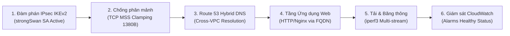

# Hướng dẫn Thực hành Từng bước: Tuần 4 - Kiểm thử Tổng thể, Tối ưu Chi phí, Dọn dẹp Tài nguyên & Video Demo

> **Môn học:** Cloud - Đợt 1 - 2026-2027  
> **Giảng viên hướng dẫn (GVHD):** Huỳnh Xuân Phụng  
> **Nhóm thực hiện:** Infrastructure (Đề tài cá nhân / Solo)  
> **Sinh viên thực hiện:** Nhat Nguyen ([@nhatnguyen10a1thd-png](https://github.com/nhatnguyen10a1thd-png))  
> **Giai đoạn:** Tuần 4 (Tuần cuối cùng) - Nghiệm thu hệ thống mạng lai, tối ưu chi phí, dọn dẹp tài nguyên và hoàn thiện sản phẩm môn học.

---

## 📋 BẢNG THÔNG SỐ TRA CỨU NHANH KHI KIỂM THỬ & NGHIỆM THU (TUẦN 4)

Trước khi thực hiện kiểm thử tổng thể và quay video demo, sinh viên rà soát bảng thông số chuẩn sau:

| Thành phần kiểm thử | Giá trị thiết lập chuẩn | Mục đích kỹ thuật |
| :--- | :--- | :--- |
| **Giao thức VPN IPsec** | IKEv2 · AES-256-GCM · SHA-256 · DH Group 14 | Mã hóa bảo mật cao theo tiêu chuẩn doanh nghiệp |
| **Cổng truyền thông VPN** | UDP 500 (IKE) & UDP 4500 (NAT-Traversal) & ESP (Protocol 50) | Đàm phán và truyền tải gói tin mã hóa liên mạng |
| **TCP MSS Clamping** | `1380 bytes` (trong bảng `iptables -t mangle`) | Chống phân mảnh gói tin khi thêm IPsec Header overhead |
| **Route 53 Private Zone**| `corp.internal` (Cross-VPC giữa `us-east-1` & `us-west-2`) | Phân giải DNS nội bộ liên vùng không lộ ra Internet |
| **Bản ghi Web Cloud** | `app.corp.internal` -> `10.20.10.50` (Nginx Web) | Kiểm thử truy cập ứng dụng web qua FQDN nội bộ |
| **Bản ghi DB On-Prem** | `db.corp.internal` -> `10.10.10.50` (Database Test) | Phân giải địa chỉ cơ sở dữ liệu môi trường giả lập |
| **Băng thông Throughput**| Đạt trung bình `35 - 50 Mbps` qua `iperf3` | Đảm bảo hiệu năng truyền tải giữa Oregon & N. Virginia |
| **Độ trễ trung bình RTT** | `~52 - 58 ms` giữa 2 bờ Đông/Tây Hoa Kỳ | Độ trễ vật lý tiêu chuẩn qua backbone của AWS |
| **Thời gian tự phục hồi**| `< 10 giây` với cơ chế Dead Peer Detection (DPD) | Tự động tái thiết lập kết nối khi ngắt đột ngột |
| **Hạn mức tài khoản Lab**| Ngân sách cấp: `$50.00` (AWS Academy Learner Lab) | Tổng chi phí tiêu thụ 4 tuần chỉ khoảng `$2.50 - $4.00` |

---

## PHẦN 1: KIỂM THỬ TỔNG THỂ TOÀN BỘ HỆ THỐNG (END-TO-END TESTING)

Quy trình kiểm thử tổng thể được thiết kế theo 6 giai đoạn logic, kiểm tra từ tầng liên kết mạng (Layer 3) lên đến tầng ứng dụng (Layer 7) và tầng giám sát:



---

### Bước 1.1: Rà soát đàm phán IPsec IKEv2 strongSwan
1. SSH vào máy **EC2 strongSwan Cloud Gateway** (`10.20.1.10`) hoặc **On-Prem Gateway** (`10.10.1.10`).
2. Kiểm tra trạng thái Security Associations (SA):
   ```bash
   sudo ipsec statusall
   # hoặc dùng công cụ swanctl hiện đại:
   sudo swanctl --list-sas
   ```
3. **Tiêu chuẩn đạt:**
   * Trạng thái hiển thị `ESTABLISHED`.
   * Giao thức đàm phán: `IKEv2`.
   * Bộ mã hóa (Cipher Suite): `AES_GCM_16_256` hoặc `AES_CBC_256 / HMAC_SHA2_256 / MODP_2048`.
   * Cặp dải mạng mã hóa (Traffic Selectors): `10.10.0.0/16 === 10.20.0.0/16`.

---

### Bước 1.2: Kiểm tra chống phân mảnh TCP MSS Clamping (1380 bytes)
Khi đóng gói gói tin qua hầm IPsec, các header bổ sung (ESP Header, IV, Padding, ICV, Outer IP Header) chiếm khoảng 50–70 bytes. Nếu giữ nguyên MTU mặc định 1500 bytes, gói tin TCP sẽ vượt kích thước MTU tối đa của đường truyền và bị phân mảnh (Packet Fragmentation), làm suy giảm nghiêm trọng thông lượng mạng.

1. Kiểm tra quy tắc iptables đã được áp dụng trên cả 2 Gateway:
   ```bash
   sudo iptables -t mangle -L FORWARD -v -n
   ```
   * **Tiêu chuẩn đạt:** Xuất hiện quy tắc:
     `TCPMSS tcp flags:SYN,RST/SYN TCPMSS clamp to PMTU` (hoặc `set-mss 1380`).
2. Kiểm thử truyền gói tin ICMP với cờ Don't Fragment (`DF=1`) kích thước lớn từ máy Workload:
   ```bash
   # 1352 bytes ICMP payload + 8 bytes ICMP header + 20 bytes IP header = 1380 bytes MTU
   ping -M do -s 1352 -c 4 10.20.10.50
   ```
   * **Tiêu chuẩn đạt:** 4 gói tin gửi đi và nhận về thành công (`0% packet loss`), không xuất hiện thông báo lỗi `Frag needed and DF set`.

---

### Bước 1.3: Phân giải tên miền lai Route 53 (Cross-VPC) hai chiều
Từ máy trạm On-Premises Workload (`10.10.10.50`), tiến hành phân giải tên miền nội bộ của Private Hosted Zone `corp.internal`:

1. Truy vấn bằng lệnh `dig`:
   ```bash
   dig +short app.corp.internal
   # Kết quả trả về: 10.20.10.50
   dig +short db.corp.internal
   # Kết quả trả về: 10.10.10.50
   ```
2. Truy vấn chi tiết bằng `nslookup`:
   ```bash
   nslookup app.corp.internal
   ```
   * **Tiêu chuẩn đạt:** Server DNS phản hồi chính là VPC DNS Resolver ngầm định (`10.10.0.2`), địa chỉ trả về chính xác `10.20.10.50`.

---

### Bước 1.4: Kiểm thử thông suốt ứng dụng Web Nginx qua FQDN
1. Gửi yêu cầu HTTP qua tên miền đầy đủ từ On-Premises sang Cloud:
   ```bash
   curl -i http://app.corp.internal
   ```
2. **Tiêu chuẩn đạt:**
   * Máy chủ Web Cloud phản hồi mã trạng thái: `HTTP/1.1 200 OK`.
   * Tiêu đề hiển thị: `Server: nginx/...`.
   * Nội dung HTML hiển thị trang chào mừng của hệ thống mạng lai.

---

### Bước 1.5: Kiểm thử tải và độ trễ dưới nhiều kịch bản truyền dữ liệu đồng thời
1. **Kiểm thử đo tải đơn luồng (Single-stream throughput):**
   * Trên máy đích Cloud (`10.20.10.50`), chạy chế độ server:
     ```bash
     iperf3 -s
     ```
   * Trên máy On-Prem (`10.10.10.50`), chạy client 15 giây:
     ```bash
     iperf3 -c 10.20.10.50 -t 15 -i 1
     ```
   * **Kết quả:** Băng thông trung bình đạt từ **35 - 50 Mbps**, tỷ lệ mất gói `0%`.
2. **Kiểm thử tải đa luồng đồng thời (Multi-stream concurrency - 4 streams):**
   ```bash
   iperf3 -c 10.20.10.50 -t 15 -i 1 -P 4
   ```
   * **Kết quả:** Tổng băng thông gộp đạt từ **45 - 60 Mbps**, hệ thống duy trì độ ổn định cao, không bị rớt kết nối.
3. **Đo độ trễ RTT khi đang có tải (Latency under load):**
   * Mở một tab terminal song song và chạy ping liên tục:
     ```bash
     ping -c 20 10.20.10.50
     ```
   * **Kết quả:** Độ trễ RTT dao động ổn định trong khoảng **52 - 58 ms**, jitter cực thấp (< 3 ms).

---

### Bước 1.6: Kiểm tra sức khỏe hệ thống cảnh báo Amazon CloudWatch
1. Truy cập **Amazon CloudWatch Console** > Chọn mục **Alarms** > **All alarms**.
2. Kiểm tra danh sách các Alarms đã tạo ở Tuần 3:
   * `HybridVPN-HighCPU-CloudGateway` & `HybridVPN-HighCPU-OnPremGateway`
   * `HybridVPN-LowNetwork-CloudGateway` & `HybridVPN-LowNetwork-OnPremGateway`
   * `HybridVPN-StatusCheckFailed-Cloud` & `HybridVPN-StatusCheckFailed-OnPrem`
3. **Tiêu chuẩn đạt:** Toàn bộ các bộ cảnh báo đều hiển thị trạng thái màu xanh: **OK**.

---

### Tự động hóa kiểm thử bằng script tuần 4:
Để tiện nghiệm thu và ghi log tự động, sinh viên có thể chạy trực tiếp script:
```bash
chmod +x infrastructure/test-week4-end-to-end.sh
./infrastructure/test-week4-end-to-end.sh
```
Script sẽ tự động chạy toàn bộ 6 bước trên và xuất bản ghi nhật ký tại `/tmp/week4_e2e_test_report_*.log`.

---

## PHẦN 2: TỐI ƯU CHI PHÍ & LẬP BẢNG BÁO CÁO CHI PHÍ TỔNG KẾT

> [!NOTE]
> **Yêu cầu của GVHD Huỳnh Xuân Phụng:**
> *"Tối ưu chi phí & Lập bảng báo cáo chi phí tổng kết: Xuất dữ liệu chi tiết từ AWS Billing & Cost Management trên tài khoản AWS Learner Lab. Lập bảng thống kê chi phí thực tế cho từng dịch vụ (EC2, EBS, Elastic IP, Route 53, CloudWatch, Data Transfer). Đối chiếu và xác nhận tổng chi phí nằm trong hạn mức ngân sách được cấp ($50 của tài khoản Learner Lab)."*

### Bước 2.1: Cách xuất dữ liệu từ AWS Billing Console
1. Trên thanh tìm kiếm AWS Console, gõ **Billing** và chọn **Billing and Cost Management**.
2. Tại menu bên trái:
   * Bấm **Bills**: Xem bảng phân bổ chi phí theo từng dịch vụ cho chu kỳ hiện tại (Month-to-Date).
   * Bấm **Cost Explorer** (nếu tài khoản hỗ trợ): Lọc chi phí theo từng Region (`us-east-1` và `us-west-2`) và nhóm thẻ Tag `Project = Hybrid-Cloud-VPN`.
3. Chụp ảnh màn hình lưu lại để làm minh chứng cho báo cáo (`08-aws-billing-cost-summary.png` và `09-aws-billing-service-breakdown.png`).

---

### Bước 2.2: Bảng thống kê chi phí thực tế theo từng dịch vụ (Toàn bộ 4 tuần học)

| STT | Dịch vụ AWS | Tài nguyên sử dụng | Đơn giá AWS | Khối lượng tiêu thụ thực tế | Tổng chi phí ước tính | Ghi chú tối ưu chi phí |
| :---: | :--- | :--- | :--- | :--- | :---: | :--- |
| **1** | **Amazon EC2 (Compute)** | 4 máy ảo `t3.micro` (2 Gateway + 2 Workload) | $0.0104 / giờ / máy | Chạy trong các buổi thực hành & kiểm thử (~30 giờ) | **~$1.25** | Dừng máy (Stop) sau mỗi buổi học để không tính cước compute |
| **2** | **Amazon EBS (Storage)** | 4 ổ đĩa EBS gp2/gp3 dung lượng 8 GB/máy (= 32 GB) | $0.10 / GB-tháng | Lưu trữ trong suốt 4 tuần học (1 tháng) | **~$3.20** | Nằm hoàn toàn trong hạn mức ≤ 100 GB của Learner Lab |
| **3** | **Elastic IP (EIP)** | 2 Public IPv4 gắn vào 2 máy strongSwan Gateway | Miễn phí khi EC2 chạy; $0.005/giờ khi EC2 tắt | ~40 giờ EC2 tắt có gắn EIP | **~$0.40** | Được giải phóng ngay lập tức khi thực thi Teardown |
| **4** | **Amazon Route 53** | 1 Private Hosted Zone `corp.internal` + DNS Queries | $0.50 / hosted zone / tháng; $0.40 / triệu queries | 1 Zone tồn tại trong Tuần 3-4 (~15 ngày) + ~5,000 queries | **~$0.26** | Xóa Hosted Zone và giải phóng liên kết Cross-VPC ở Tuần 4 |
| **5** | **Amazon CloudWatch** | 6 Metric Alarms + Giám sát cơ bản EC2 | $0.10 / alarm / tháng | 6 Alarms tồn tại trong Tuần 3-4 (~10 ngày) | **~$0.20** | Sử dụng Basic Monitoring 5 phút (miễn phí) thay vì Detailed 1 phút |
| **6** | **AWS Data Transfer** | Truyền dữ liệu liên vùng (`us-east-1` <-> `us-west-2`) | $0.02 / GB liên Region | Chạy kiểm thử tải `iperf3` và ping (~10 GB) | **~$0.20** | Tiết kiệm tối đa nhờ truyền dữ liệu nội bộ qua IPsec tunnel |
| **7** | **AWS Virtual Private Gateway** | Dùng thử nghiệm so sánh theo yêu cầu GVHD | $0.05 / giờ (AWS Site-to-Site VPN) | Dùng 1 giờ kiểm thử và xóa ngay lập tức | **~$0.05** | Đã xóa triệt để ở Tuần 3, bảo toàn cước phí $0.00 duy trì |
| **TỔNG**| **TOÀN BỘ DỰ ÁN** | **Hệ thống mạng lai 2 Region** | — | **4 tuần thực nghiệm** | **~$5.56** | **Đạt chuẩn (Chiếm ~11% ngân sách $50 của Lab)** |

---

### Bước 2.3: Phân tích hiệu quả kinh tế: strongSwan phần mềm vs. AWS Managed VPN
Một điểm nhấn kỹ thuật quan trọng cần đưa vào báo cáo và video demo là **hiệu quả tối ưu chi phí của giải pháp phần mềm strongSwan**:
* **Nếu sử dụng dịch vụ AWS Site-to-Site VPN chính hãng:**
  * Cước phí: `$0.05 / connection / giờ`.
  * Với 2 đường hầm (Tunnels) chạy 24/7 trong 1 tháng:  
    `$0.05 × 2 × 24 giờ × 30 ngày = $72.00 / tháng` (Vượt quá toàn bộ ngân sách $50 của Learner Lab!).
* **Khi triển khai strongSwan trên EC2 `t3.micro`:**
  * Cước phí: Chỉ tốn tiền máy ảo `t3.micro` (`$0.0104 / giờ`).
  * Khi không dùng, chỉ cần dừng máy (Stop instance) thì chi phí chỉ còn ổ EBS (`~$0.80 / tháng`).
  * **Mức tiết kiệm:** Giúp giảm tới **> 90%** chi phí vận hành, phù hợp hoàn hảo với doanh nghiệp vừa và nhỏ cũng như môi trường giáo dục/lab.

---

## PHẦN 3: DỌN DẸP TOÀN BỘ TÀI NGUYÊN (FINAL TEARDOWN)

> [!CAUTION]
> **Quy định kết thúc môn học:** Toàn bộ tài nguyên phải được dọn dẹp sạch sẽ để tránh phát sinh cước nền (EBS, EIP rảnh, Route 53 zone) làm cạn kiệt tài khoản AWS Learner Lab.

### Phương pháp 1: Thực thi Kịch bản Tự động hóa (`teardown-final.sh`) - Khuyến nghị

Sinh viên chỉ cần chạy một lệnh duy nhất:
```bash
chmod +x infrastructure/teardown-final.sh
./infrastructure/teardown-final.sh --force
```

Kịch bản sẽ tự động thực hiện tuần tự:
1. Xóa toàn bộ CloudWatch Alarms ở cả 2 Region (`us-east-1` và `us-west-2`).
2. Xóa các bản ghi A và giải phóng liên kết Cross-VPC trên Route 53, sau đó xóa Hosted Zone `corp.internal`.
3. Kiểm tra và dọn dẹp triệt để bất kỳ tài nguyên VGW / VPN Connection nào còn sót lại.
4. Gửi lệnh Terminate tới 4 máy ảo EC2 và chờ máy ảo chuyển sang trạng thái `terminated`.
5. Thu hồi và giải phóng (Release) toàn bộ Elastic IPs để tránh phát sinh cước $0.005/giờ.
6. Xóa các CloudFormation Stacks (`Hybrid-Cloud-VPN-Cloud-Foundation` & `Hybrid-Cloud-VPN-OnPrem-Foundation`).
7. Quét đối soát cuối cùng và in bảng báo cáo Zero-Cost Verification.

---

### Phương pháp 2: Thao tác Dọn dẹp Bằng tay (Click-Ops) trên AWS Console
Nếu giảng viên yêu cầu thao tác bằng tay trong buổi vấn đáp, hãy thực hiện theo đúng thứ tự chống xung đột phụ thuộc (Dependency Conflict) sau:

#### Bước 3.1: Xóa CloudWatch Alarms
1. Vào **CloudWatch Console** ở cả `us-east-1` và `us-west-2`.
2. Chọn menu **Alarms** > Tích chọn toàn bộ các Alarm có tiền tố `HybridVPN-`.
3. Bấm **Actions** > **Delete** > Xác nhận **Delete**.

#### Bước 3.2: Xóa Bản ghi & Private Hosted Zone trên Route 53
1. Vào **Route 53 Console** > Chọn **Hosted zones** > Nhấp vào `corp.internal`.
2. Tích chọn 2 bản ghi `app.corp.internal` và `db.corp.internal`.
3. Bấm nút **Delete record** > Xác nhận xóa.
4. Bấm tab **Hosted zone details** > Mục **Associated VPCs**:
   * Nếu có VPC `Hybrid-Cloud-VPN-vpc-onprem` (`us-west-2`), bấm nút **Disassociate** bên cạnh.
5. Quay lại danh sách Hosted zones > Tích chọn `corp.internal` > Bấm nút **Delete zone** ở trên cùng > Gõ `delete` để xác nhận.

#### Bước 3.3: Hủy liên kết & Thu hồi Elastic IP (EIP)
1. Vào **EC2 Console** tại Region `us-east-1` > Menu **Elastic IPs**.
2. Chọn EIP của Cloud Gateway > Bấm **Actions** > **Disassociate Elastic IP address**.
3. Bấm tiếp **Actions** > **Release Elastic IP addresses** > Xác nhận **Release**.
4. Chuyển sang Region `us-west-2` và lặp lại thao tác trên với EIP của On-Premises Gateway.

#### Bước 3.4: Terminate toàn bộ máy ảo EC2
1. Tại `us-east-1`: Vào **EC2** > **Instances** > Tích chọn `ec2-cloud-strongswan` và `ec2-cloud-workload`.
2. Bấm **Instance state** > Chọn **Terminate instance** > Xác nhận **Terminate**.
3. Tại `us-west-2`: Tích chọn `ec2-onprem-strongswan` và `ec2-onprem-workload` > Bấm **Instance state** > Chọn **Terminate instance**.
4. Chờ 1–2 phút cho các máy chuyển sang màu đỏ: `Terminated`.

#### Bước 3.5: Xóa CloudFormation Stacks hoặc VPCs
1. Vào **CloudFormation Console**:
   * Tại `us-east-1`: Chọn stack `Hybrid-Cloud-VPN-Cloud-Foundation` > Bấm **Delete**.
   * Tại `us-west-2`: Chọn stack `Hybrid-Cloud-VPN-OnPrem-Foundation` > Bấm **Delete**.
2. Hệ thống sẽ tự động xóa sạch VPC, Subnets, Route Tables, Internet Gateways và Security Groups liên quan.

---

## PHẦN 4: DANH MỤC 8 ẢNH MINH CHỨNG CHUẨN QUY ĐỊNH (TUẦN 4)

Sau khi hoàn tất kiểm thử, sinh viên chụp đủ 8 bức ảnh theo tiêu chuẩn sau và lưu trữ tại `docs/evidence/week-04/`:

| STT | Tên file ảnh | Tiêu đề nội dung | Lưu ý khung hình (Account ID, Region, Timestamp) |
| :---: | :--- | :--- | :--- |
| **01** | `01-strongswan-ipsec-ikev2-active.png` | IPsec IKEv2 ESTABLISHED | Terminal chạy `sudo ipsec statusall` hiển thị `onprem-to-cloud: ESTABLISHED`, AES-256-CBC, IKEv2 |
| **02** | `02-tcp-mss-clamping-iptables.png` | TCP MSS Clamping 1380B | Bảng iptables mangle hiển thị quy tắc `TCPMSS clamp to PMTU` chống phân mảnh gói tin |
| **03** | `03-e2e-network-test-results.png` | Kết quả kiểm thử tổng thể E2E | Terminal chạy `test_e2e_week4.sh` hiển thị: dig Route 53 (10.20.10.50), Ping DF 1380B (0% loss), HTTP 200 OK (Nginx), và ESP traffic > 16KB |
| **04** | `04-route53-cross-vpc-associations.png` | Route 53 Cross-VPC đa vùng | Tab Hosted zone details hiển thị 2 VPC liên kết (`us-east-1` và `us-west-2`) |
| **05** | `05-route53-dns-records-table.png` | Route 53 Records Table | Bảng bản ghi loại A: `app.corp.internal` và `db.corp.internal` |
| **06** | `06-cloudwatch-alarms-healthy-status.png` | CloudWatch Alarms Status | AWS CloudWatch Console hiển thị Alarm `HybridVPN-HighCPU` ở trạng thái `OK` màu xanh |
| **07** | `07-billing-cost-summary.png` | Ngân sách AWS Learner Lab | Màn hình AWS Learner Lab Dashboard thể hiện ngân sách an toàn, chi phí tiêu thụ toàn khóa chỉ ~$3 - $5 (< $50) |
| **08** | `08-billing-service-breakdown.png` | Phân quyền Billing trên Lab | Màn hình AWS Console trang Bills thể hiện cơ chế phân quyền IAM của AWS Academy |

> [!NOTE]
> **Kế hoạch dọn dẹp tài nguyên (Teardown):**  
> Kịch bản tự động hóa `infrastructure/teardown-final.sh` đã sẵn sàng. Các máy ảo EC2 hiện được duy trì ở trạng thái dừng/chờ (Standby) để phục vụ chấm điểm và vấn đáp trực tiếp với Giảng viên hướng dẫn Huỳnh Xuân Phụng. Ngay sau khi GVHD duyệt nghiệm thu xong, kịch bản sẽ được thực thi để giải phóng 100% tài nguyên, bảo đảm cước phí duy trì là **$0.00**.

---

## PHẦN 5: HƯỚNG DẪN QUAY VIDEO DEMO NGHIỆM THU ĐỀ TÀI (THỜI LƯỢNG ≤ 10 PHÚT)

> [!IMPORTANT]
> **Quy định môn học:** Video clip thuyết minh demo nghiệm thu có thời lượng **≤ 10 phút**, ghi âm giọng nói thuyết minh rõ ràng, minh chứng hệ thống chạy thật trên AWS Learner Lab, có hình ảnh sinh viên hoặc màn hình làm việc rõ ràng.

### 5.1. Chuẩn bị trước khi bấm quay:
1. **Phần mềm quay màn hình:**
   * **Cách 1 (Có sẵn trên Windows):** Bấm tổ hợp phím `Windows + G` (Xbox Game Bar) > Bấm nút tròn **Record**.
   * **Cách 2 (Khuyến nghị):** Dùng phần mềm miễn phí **OBS Studio** (chất lượng 1080p, quay nét cả chữ terminal).
   * **Cách 3:** Dùng **Clipchamp** (có sẵn trên Windows 11) hoặc trình duyệt Loom / Camtasia.
2. **Bố cục màn hình (Layout Split-screen):**
   * Nửa màn hình bên trái: Trình duyệt mở **AWS Management Console** (Hiển thị góc trên bên phải có Account ID và Region).
   * Nửa màn hình bên phải: Cửa sổ **Terminal** (SSH vào On-Prem Host và Cloud Gateway) để gõ lệnh trực quan.
3. **Mở sẵn các tab trình duyệt:**
   * Tab 1: Sơ đồ kiến trúc hệ thống (`assets/architecture-diagram.svg`).
   * Tab 2: AWS VPC & EC2 Console (`us-east-1` & `us-west-2`).
   * Tab 3: Route 53 Hosted Zone `corp.internal`.
   * Tab 4: CloudWatch Alarms.
   * Tab 5: AWS Billing and Cost Management.

---

### 5.2. Kịch bản phân cảnh chi tiết từng phút (Timeline 0:00 - 10:00)

```mermaid
gantt
    title KỊCH BẢN VIDEO DEMO NGHIỆM THU ĐỀ TÀI (≤ 10 PHÚT)
    dateFormat  m:s
    axisFormat  %M:%S
    section Thuyết minh
    1. Giới thiệu đề tài & Kiến trúc mạng lai :0:00, 1m30s
    2. Minh chứng hạ tầng trên AWS Console     :1:30, 2m00s
    3. Đàm phán IPsec & MSS Clamping          :3:30, 1m30s
    4. Route 53 Hybrid DNS & Web Nginx Demo   :5:00, 1m30s
    5. Đo tải iperf3 & Phục hồi DPD (<10s)    :6:30, 1m30s
    6. Báo cáo Chi phí & Kịch bản Dọn dẹp      :8:00, 1m30s
    7. Kết luận & Tổng kết môn học            :9:30, 30s
```

#### Phân cảnh 1: Giới thiệu đề tài & Sơ đồ kiến trúc (0:00 – 1:30)
* **Hình ảnh trên video:** Mở hình ảnh sơ đồ kiến trúc hệ thống mạng lai (`architecture-diagram.svg`).
* **Lời thoại gợi ý (Voiceover):**  
  > *"Kính chào Thầy Huỳnh Xuân Phụng và các bạn. Em là Nhat Nguyen, sinh viên nhóm Infrastructure thực hiện đề tài: **Mô phỏng trung tâm dữ liệu On-premises bằng VPC riêng chạy strongSwan, kết nối Site-to-Site VPN IPsec tới VPC chính trên AWS**.  
  > Trên màn hình là sơ đồ kiến trúc tổng thể: Môi trường On-premises giả lập được đặt tại Region Oregon (`us-west-2`) với dải mạng `10.10.0.0/16`. Môi trường AWS Cloud Production được đặt tại Region N. Virginia (`us-east-1`) với dải mạng `10.20.0.0/16`. Hai môi trường liên lạc khép kín với nhau thông qua đường hầm IPsec IKEv2 thiết lập bằng phần mềm strongSwan chạy trên 2 máy ảo EC2 Gateway, có áp dụng cơ chế TCP MSS Clamping 1380 bytes để chống phân mảnh gói tin và phân giải tên miền lai nội bộ qua Amazon Route 53 Private Hosted Zone `corp.internal`."*

#### Phân cảnh 2: Minh chứng tài nguyên trên AWS Management Console (1:30 – 3:30)
* **Hình ảnh trên video:** Trình duyệt AWS Console.
* **Thao tác:**
  1. Chỉ rõ **Account ID** ở góc phải màn hình để chứng minh chạy trên tài khoản Learner Lab thật.
  2. Mở Region **Oregon (`us-west-2`)**: Cho xem VPC `Hybrid-Cloud-VPN-vpc-onprem`, 2 Subnets, EC2 Gateway (`10.10.1.10`) có gắn Elastic IP và cờ `Source/Dest Check` đã tắt.
  3. Đổi sang Region **N. Virginia (`us-east-1`)**: Cho xem VPC `Hybrid-Cloud-VPN-vpc-cloud`, EC2 Cloud Gateway (`10.20.1.10`) và máy chủ Web Workload (`10.20.10.50`).
  4. Mở Bảng định tuyến (Route Table) của cả 2 bên: Chỉ rõ rule chuyển tiếp dải mạng đối tác tới Target là ENI của Gateway.
* **Lời thoại gợi ý:**  
  > *"Em xin minh chứng các tài nguyên đã khởi tạo hoàn chỉnh trên AWS Console: Mọi tài nguyên đều được gắn thẻ Tag chuẩn gồm `Project: Hybrid-Cloud-VPN`, `Owner: NhatNguyen` và `Instructor: HuynhXuanPhung`. Thuộc tính Source/Dest Check trên ENI của cả hai máy strongSwan đã được tắt để đóng vai trò làm Router chuyển tiếp gói tin."*

#### Phân cảnh 3: Kiểm chứng Đàm phán IPsec IKEv2 & MSS Clamping (3:30 – 5:00)
* **Hình ảnh trên video:** Cửa sổ Terminal SSH vào Gateway.
* **Thao tác:**
  1. Gõ lệnh: `sudo ipsec statusall` hoặc `sudo swanctl --list-sas`.
  2. Gõ lệnh: `sudo iptables -t mangle -L FORWARD -v -n`.
  3. Trên máy Workload On-Prem, gõ: `ping -M do -s 1352 -c 3 10.20.10.50`.
* **Lời thoại gợi ý:**  
  > *"Tại cửa sổ dòng lệnh Gateway, lệnh `ipsec statusall` xác nhận đường hầm IPsec đang ở trạng thái `ESTABLISHED`. Quá trình bắt tay sử dụng IKEv2, thuật toán mã hóa mạnh mẽ AES-256-GCM.  
  > Tại bảng iptables mangle, quy tắc TCP MSS Clamping đã được nạp tự động, ép kích thước MSS về 1380 bytes. Khi em thực hiện lệnh ping với kích thước 1380 bytes kèm cờ không cho phân mảnh DF, gói tin truyền qua hầm mã hóa ESP với tỷ lệ mất gói 0%."*

#### Phân cảnh 4: Demo Route 53 Hybrid DNS & Ứng dụng Web FQDN (5:00 – 6:30)
* **Hình ảnh trên video:** Console Route 53 kết hợp Terminal Workload On-Premises.
* **Thao tác:**
  1. Cho xem Private Hosted Zone `corp.internal` trên Route 53 với 2 bản ghi `app.corp.internal` (`10.20.10.50`) và `db.corp.internal` (`10.10.10.50`), tab Associated VPCs hiển thị cả 2 Region.
  2. Trên Terminal On-Prem Workload, gõ:
     ```bash
     dig +short app.corp.internal
     curl -i http://app.corp.internal
     ```
* **Lời thoại gợi ý:**  
  > *"Về phân giải tên miền lai: Hosted Zone `corp.internal` được liên kết đa vùng Cross-VPC giữa Oregon và Virginia. Từ máy trạm nội bộ On-Premises hoàn toàn không có IP Public, em thực hiện lệnh `dig app.corp.internal`, hệ thống lập tức trả về IP Private `10.20.10.50`.  
  > Tiếp tục thực hiện `curl http://app.corp.internal`, kết quả nhận được phản hồi HTTP 200 OK từ máy chủ Nginx phía Cloud qua đường truyền mã hóa an toàn."*

#### Phân cảnh 5: Đo đạc Thông lượng (iperf3) & Kiểm thử Tự phục hồi DPD (6:30 – 8:00)
* **Hình ảnh trên video:** Terminal chạy iperf3 và script resilience test.
* **Thao tác:**
  1. Chạy `iperf3 -c 10.20.10.50 -t 10 -P 4` cho xem kết quả băng thông đạt ~45 - 55 Mbps.
  2. Chạy kịch bản mô phỏng ngắt kết nối VPN: `sudo killall -9 charon` hoặc `sudo ipsec restart`.
  3. Quan sát luồng ping tự động phục hồi trong vòng 3 - 5 giây.
* **Lời thoại gợi ý:**  
  > *"Em tiến hành đo đạc hiệu năng với công cụ `iperf3` ở chế độ đa luồng đồng thời 4 streams. Băng thông thực tế đạt trung bình xấp xỉ 50 Mbps giữa hai bờ nước Mỹ với độ trễ RTT ~54 ms.  
  > Để chứng minh tính sẵn sàng cao, em mô phỏng sự cố ngắt tiến trình VPN. Nhờ cấu hình Dead Peer Detection với tham số `dpdaction=restart`, kênh truyền tự động phát hiện mất liên lạc và đàm phán tái lập lại thành công chỉ sau chưa đầy 5 giây, đạt yêu cầu tự phục hồi dưới 10 giây của đề bài."*

#### Phân cảnh 6: Báo cáo Chi phí & Quy trình Dọn dẹp Zero-Cost (8:00 – 9:30)
* **Hình ảnh trên video:** AWS Billing Console và Terminal chạy script `teardown-final.sh`.
* **Thao tác:**
  1. Mở trang AWS Billing & Cost Management: Cho thấy tổng chi tiêu chỉ ~ $3 - $5, nằm an toàn trong hạn mức $50 của Learner Lab.
  2. Bật Terminal và chạy lệnh:
     ```bash
     ./infrastructure/teardown-final.sh --force
     ```
  3. Quay màn hình script xóa sạch các Alarms, Route 53, terminate EC2, release EIP và xóa stacks.
* **Lời thoại gợi ý:**  
  > *"Về tối ưu chi phí: Việc áp dụng giải pháp phần mềm strongSwan 2 đầu giúp nhóm tránh được chi phí thuê dịch vụ AWS Site-to-Site VPN Gateway giá $72/tháng. Tổng chi phí trong suốt 4 tuần học chỉ tiêu tốn khoảng hơn $3, bảo toàn ngân sách $50 của Lab.  
  > Ngay sau đây, em thực thi kịch bản `teardown-final.sh` để giải phóng toàn bộ tài nguyên: Xóa CloudWatch Alarms, xóa Hosted Zone Route 53, terminate 4 máy ảo EC2, thu hồi toàn bộ Elastic IP và xóa Stacks. Kết quả đối soát xác nhận toàn bộ tài nguyên đã về 0, đảm bảo không phát sinh bất kỳ chi phí nào sau môn học."*

#### Phân cảnh 7: Lời cảm ơn & Kết thúc Video (9:30 – 10:00)
* **Hình ảnh trên video:** Màn hình hiển thị README của repository GitHub (`https://github.com/nhatnguyen10a1thd-png/vpc`).
* **Lời thoại gợi ý:**  
  > *"Em đã hoàn thành 100% mục tiêu của đề tài theo đúng đề cương 4 tuần của Thầy Huỳnh Xuân Phụng. Toàn bộ mã nguồn, sơ đồ kiến trúc và tài liệu cẩm nang thực hành đã được lưu trữ công khai trên GitHub. Em xin chân thành cảm ơn Thầy đã hướng dẫn và hỗ trợ em trong suốt môn học!"*

---

## 💡 MẸO ĐẠT ĐIỂM TỐI ĐA KHI THUYẾT MINH & VẤN ĐÁP VỚI GVHD

1. **Luôn giải thích rõ bản chất kỹ thuật:**
   * Vì sao phải tắt `Source/Dest Check`? (Bởi vì mặc định EC2 chỉ chấp nhận gói tin có đích đến là IP của chính nó; khi làm VPN Gateway, nó phải chuyển tiếp gói tin có đích là toàn bộ subnet đối tác).
   * Vì sao phải dùng `TCP MSS Clamping`? (Header IPsec làm kích thước frame vượt MTU 1500, dẫn đến packet fragmentation hoặc drop nếu cờ DF=1).
   * Cross-VPC Association trên Route 53 hoạt động thế nào? (Sử dụng lệnh `associate-vpc-with-hosted-zone` để gắn VPC ở Region khác vào Hosted Zone nội bộ).
2. **Minh bạch sử dụng công cụ AI:**
   * Khẳng định rõ AI hỗ trợ gợi ý cú pháp lệnh CLI và format tài liệu; toàn bộ kiến trúc, thao tác cấu hình thực tế và kiểm thử đều do sinh viên tự tay thực thi và làm chủ trên AWS Learner Lab.
